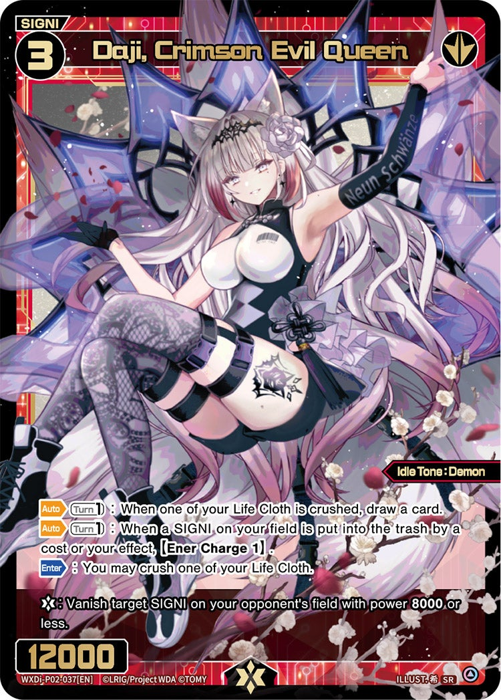

# Daji, Crimson Evil Queen

## Thông tin lá

| Trường | Giá trị |
| --- | --- |
| Mã in | WXDi-P02-037[EN] |
| Set | WXDi-P02[EN] |
| Số thứ tự | 037 |
| Loại thẻ | SIGNI |
| Vị trí | Main Deck |
| Số bản | — (set booster, không áp dụng) |
| Màu | Đỏ |
| Độ hiếm | SR |
| Minh họa | 希 |
| Level | 3 |
| Limit | — |
| Power | 12000 |
| LRIG type / Class | Idol Tone：Demon |
| Team / Master | — |
| Cost | — |
| Grow cost | — |
| Use timing | — |
| Life Burst | Có |

## Card text chính thức

[Auto] {1/Turn}: When one of your Life Cloth is crushed, draw a card.
[Auto] {1/Turn}: When a SIGNI on your field is put into the trash by a cost or your effect, 【Ener Charge 1】.
[Enter]: You may crush one of your Life Cloth.

## Power text / Life Burst

Vanish target SIGNI on your opponent's field with power 8000 or less.

## Ghi chú minh họa
Artist: 希. Ảnh SR được tải từ Card List tiếng Anh.

## FAQ chính thức

**Q. If the upper Auto Ability triggered and it's Life Cross has a Life Burst, which triggers first, the Trigger of the Lifeburst or the Trigger of the Auto Ability?**
A. In this case, since both are triggered abilities, you can choose the order of processing.

**Q. If I Retire a SIGNI (Retire：the act of moving my SIGNI to the trash, which can only do once in the main phase), does the lower Auto Ability trigger?**
A. No, Auto Ability does not Trigger because Retire is neither a cost nor an effect.

## Nguồn
[Card List/FAQ chính thức](https://www.takaratomy.co.jp/products/en.wixoss/card/card.html?card_no=WXDi-P02-037%5BEN%5D ) · [Ảnh thẻ](https://www.takaratomy.co.jp/products/en.wixoss/card/thumb/WXDi-P02-037%5BEN%5D.jpg)
