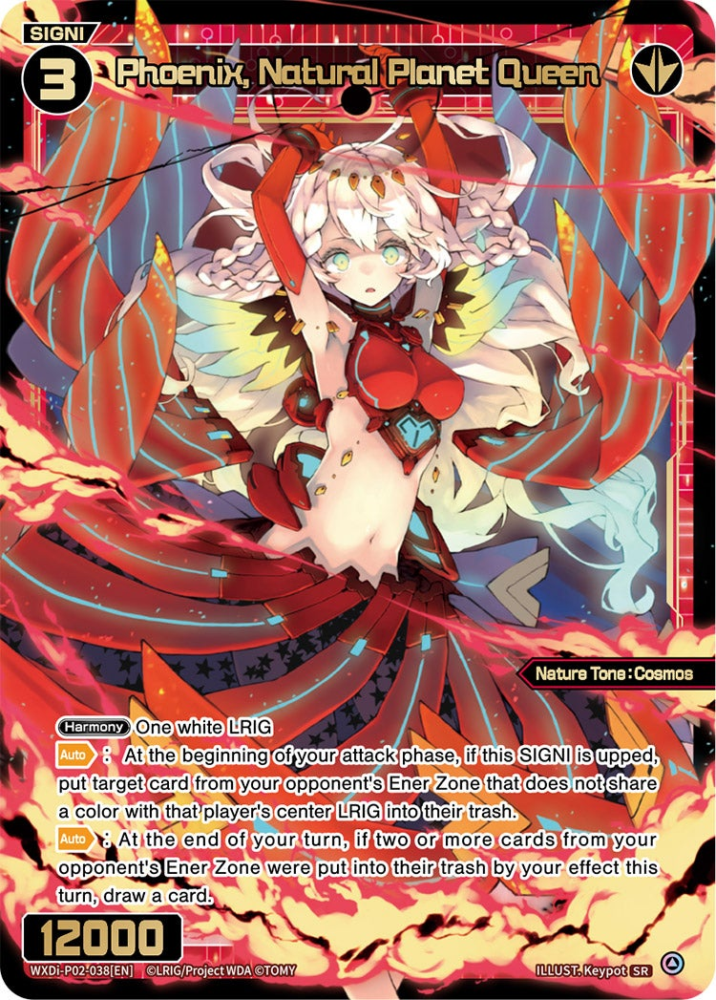

# Phoenix, Natural Planet Queen

## Thông tin lá

| Trường | Giá trị |
| --- | --- |
| Mã in | WXDi-P02-038[EN] |
| Set | WXDi-P02[EN] |
| Số thứ tự | 038 |
| Loại thẻ | SIGNI |
| Vị trí | Main Deck |
| Số bản | — (set booster, không áp dụng) |
| Màu | Đỏ |
| Độ hiếm | SR |
| Minh họa | keypot |
| Level | 3 |
| Limit | — |
| Power | 12000 |
| LRIG type / Class | Nature Tone：Cosmos |
| Team / Master | — |
| Cost | — |
| Grow cost | — |
| Use timing | — |
| Life Burst | Không |

## Card text chính thức

[Harmony] One white LRIG
[Auto]: At the beginning of your attack phase, if this SIGNI is upped, put target card from your opponent's Ener Zone that does not share a color with that player's center LRIG into their trash.
[Auto]: At the end of your turn, if two or more cards from your opponent's Ener Zone were put into their trash by your effect this turn, draw a card.

## Power text / Life Burst

—

## Ghi chú minh họa
Artist: keypot. Ảnh SR được tải từ Card List tiếng Anh.

## FAQ chính thức

— (không có FAQ riêng cho mã này trên trang FAQ tiếng Anh.)

## Nguồn
[Card List/FAQ chính thức](https://www.takaratomy.co.jp/products/en.wixoss/card/card.html?card_no=WXDi-P02-038%5BEN%5D ) · [Ảnh thẻ](https://www.takaratomy.co.jp/products/en.wixoss/card/thumb/WXDi-P02-038%5BEN%5D.jpg)
