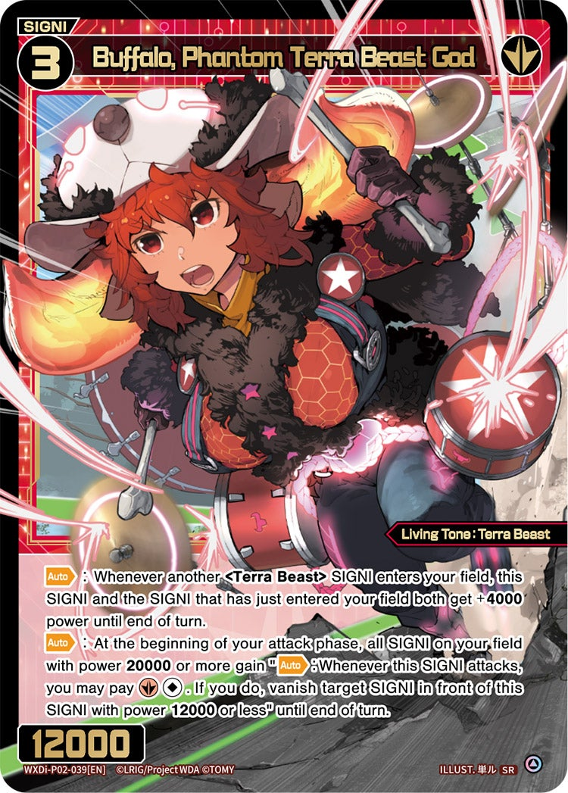

# Buffalo, Phantom Terra Beast God

## Thông tin lá

| Trường | Giá trị |
| --- | --- |
| Mã in | WXDi-P02-039[EN] |
| Set | WXDi-P02[EN] |
| Số thứ tự | 039 |
| Loại thẻ | SIGNI |
| Vị trí | Main Deck |
| Số bản | — (set booster, không áp dụng) |
| Màu | Đỏ |
| Độ hiếm | SR |
| Minh họa | 単ル |
| Level | 3 |
| Limit | — |
| Power | 12000 |
| LRIG type / Class | Living Tone：Terra Beast |
| Team / Master | — |
| Cost | — |
| Grow cost | — |
| Use timing | — |
| Life Burst | Không |

## Card text chính thức

[Auto]: Whenever another <Terra Beast> SIGNI enters your field, this SIGNI and the SIGNI that has just entered your field both get +4000 power until end of turn.
[Auto]: At the beginning of your attack phase, all SIGNI on your field with power 20000 or more gain "[Auto]: Whenever this SIGNI attacks, you may pay {Red} {Colorless}. If you do, vanish target SIGNI in front of this SIGNI with power 12000 or less" until end of turn.

## Power text / Life Burst

—

## Ghi chú minh họa
Artist: 単ル. Ảnh SR được tải từ Card List tiếng Anh.

## FAQ chính thức

**Q. If this Auto Ability vanish the SIGNI in front of this SIGNI when it attacks. Does this attack can deal damage to my opponent?**
A. Yes, damage can be dealt. Auto ability triggered by attack is processed before the battle with SIGNI in front of it. If there is no SIGNI in front of it as a result of the process, the attacking SIGNI can deal damage to the opponent.

## Nguồn
[Card List/FAQ chính thức](https://www.takaratomy.co.jp/products/en.wixoss/card/card.html?card_no=WXDi-P02-039%5BEN%5D ) · [Ảnh thẻ](https://www.takaratomy.co.jp/products/en.wixoss/card/thumb/WXDi-P02-039%5BEN%5D.jpg)
