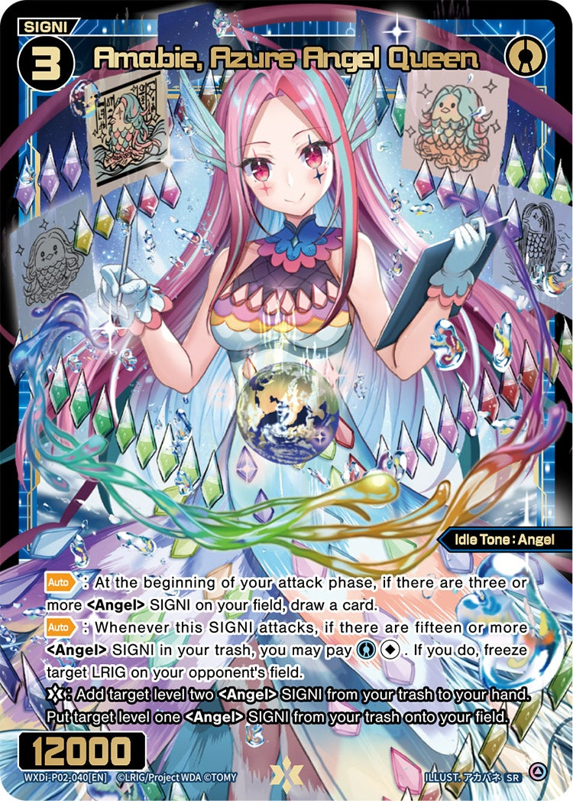

# Amabie, Azure Angel Queen

## Thông tin lá

| Trường | Giá trị |
| --- | --- |
| Mã in | WXDi-P02-040[EN] |
| Set | WXDi-P02[EN] |
| Số thứ tự | 040 |
| Loại thẻ | SIGNI |
| Vị trí | Main Deck |
| Số bản | — (set booster, không áp dụng) |
| Màu | Xanh dương |
| Độ hiếm | SR |
| Minh họa | アカバネ |
| Level | 3 |
| Limit | — |
| Power | 12000 |
| LRIG type / Class | Idol Tone：Angel |
| Team / Master | — |
| Cost | — |
| Grow cost | — |
| Use timing | — |
| Life Burst | Có |

## Card text chính thức

[Auto]: At the beginning of your attack phase, if there are three or more <Angel> SIGNI on your field, draw a card.
[Auto]: Whenever this SIGNI attacks, if there are fifteen or more <Angel> SIGNI in your trash, you may pay {Blue} {Colorless}. If you do, freeze target LRIG on your opponent's field.

## Power text / Life Burst

Add target level two <Angel> SIGNI from your trash to your hand. Put target level one <Angel> SIGNI from your trash onto your field.

## Ghi chú minh họa
Artist: アカバネ. Ảnh SR được tải từ Card List tiếng Anh.

## FAQ chính thức

**Q. When the lower Auto Ability triggers, I only had 13 <Angels> in my trash. If I pay the 《Blue》 and 《Colorless》 to get to 15 cards, can I freeze my opponent's LRIG?**
A. No, you cannot. Whether there are 15 or more <Angels> in the Trash is checked before paying the Ener Cost, and if there are not, you cannot pay 《Blue》 and 《Colorless》 in the first place.

## Nguồn
[Card List/FAQ chính thức](https://www.takaratomy.co.jp/products/en.wixoss/card/card.html?card_no=WXDi-P02-040%5BEN%5D ) · [Ảnh thẻ](https://www.takaratomy.co.jp/products/en.wixoss/card/thumb/WXDi-P02-040%5BEN%5D.jpg)
