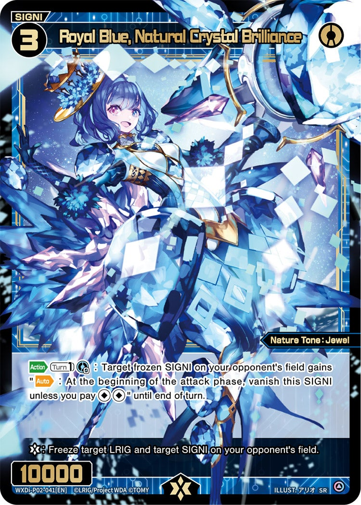

# Royal Blue, Natural Crystal Brilliance

## Thông tin lá

| Trường | Giá trị |
| --- | --- |
| Mã in | WXDi-P02-041[EN] |
| Set | WXDi-P02[EN] |
| Số thứ tự | 041 |
| Loại thẻ | SIGNI |
| Vị trí | Main Deck |
| Số bản | — (set booster, không áp dụng) |
| Màu | Xanh dương |
| Độ hiếm | SR |
| Minh họa | アリオ |
| Level | 3 |
| Limit | — |
| Power | 10000 |
| LRIG type / Class | Nature Tone：Jewel |
| Team / Master | — |
| Cost | — |
| Grow cost | — |
| Use timing | — |
| Life Burst | Có |

## Card text chính thức

[Action] {1/Turn} {Bluex0}: Target frozen SIGNI on your opponent's field gains "[Auto]: At the beginning of the attack phase, vanish this SIGNI unless you pay {Colorless} {Colorless}" until end of turn.

## Power text / Life Burst

Freeze target LRIG and target SIGNI on your opponent's field.

## Ghi chú minh họa
Artist: アリオ. Ảnh SR được tải từ Card List tiếng Anh.

## FAQ chính thức

**Q. If the Action Ability of two "Royal Blue, Natural Crystal Brilliance" is used against one opponent's frozen SIGNI.**
A. In this case, the Frozen SIGNI targeted by the two 《Royal Blue》 must pay a total of 《Colorless》 x 4 at the beginning of the Attack Phase or it will be vanished as a result.

## Nguồn
[Card List/FAQ chính thức](https://www.takaratomy.co.jp/products/en.wixoss/card/card.html?card_no=WXDi-P02-041%5BEN%5D ) · [Ảnh thẻ](https://www.takaratomy.co.jp/products/en.wixoss/card/thumb/WXDi-P02-041%5BEN%5D.jpg)
