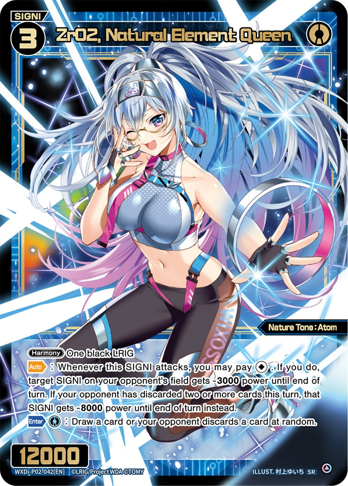

# ZrO2, Natural Element Queen

## Thông tin lá

| Trường | Giá trị |
| --- | --- |
| Mã in | WXDi-P02-042[EN] |
| Set | WXDi-P02[EN] |
| Số thứ tự | 042 |
| Loại thẻ | SIGNI |
| Vị trí | Main Deck |
| Số bản | — (set booster, không áp dụng) |
| Màu | Xanh dương |
| Độ hiếm | SR |
| Minh họa | 村上ゆいち |
| Level | 3 |
| Limit | — |
| Power | 12000 |
| LRIG type / Class | Nature Tone：Atom |
| Team / Master | — |
| Cost | — |
| Grow cost | — |
| Use timing | — |
| Life Burst | Không |

## Card text chính thức

[Harmony] One black LRIG
[Auto]: Whenever this SIGNI attacks, you may pay {Colorless}. If you do, target SIGNI on your opponent's field gets -3000 power until end of turn. If your opponent has discarded two or more cards this turn, that SIGNI gets -8000 power until end of turn instead.
[Enter] {Blue}: Draw a card or your opponent discards a card at random.

## Power text / Life Burst

—

## Ghi chú minh họa
Artist: 村上ゆいち. Ảnh SR được tải từ Card List tiếng Anh.

## FAQ chính thức

**Q. If this Auto Ability vanish the SIGNI in front of this SIGNI when it attacks. Does this attack can deal damage to my opponent?**
A. Yes, damage can be dealt. Auto ability triggered by attack is processed before the battle with SIGNI in front of it. If there is no SIGNI in front of it as a result of the process, the attacking SIGNI can deal damage to the opponent.

## Nguồn
[Card List/FAQ chính thức](https://www.takaratomy.co.jp/products/en.wixoss/card/card.html?card_no=WXDi-P02-042%5BEN%5D ) · [Ảnh thẻ](https://www.takaratomy.co.jp/products/en.wixoss/card/thumb/WXDi-P02-042%5BEN%5D.jpg)
