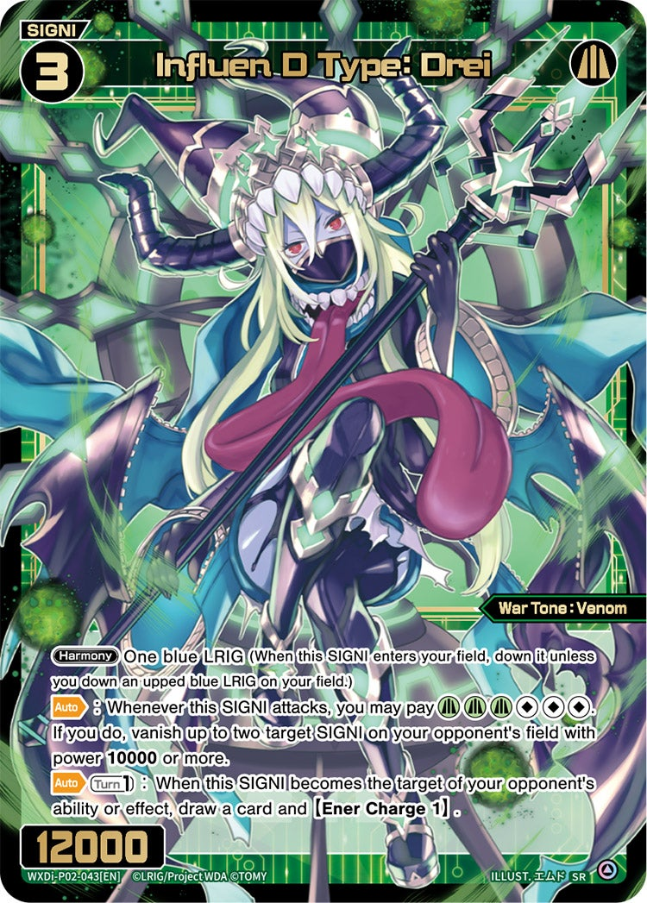

# Influen D Type: Drei

## Thông tin lá

| Trường | Giá trị |
| --- | --- |
| Mã in | WXDi-P02-043[EN] |
| Set | WXDi-P02[EN] |
| Số thứ tự | 043 |
| Loại thẻ | SIGNI |
| Vị trí | Main Deck |
| Số bản | — (set booster, không áp dụng) |
| Màu | Xanh lá |
| Độ hiếm | SR |
| Minh họa | エムド |
| Level | 3 |
| Limit | — |
| Power | 12000 |
| LRIG type / Class | War Tone：Venom |
| Team / Master | — |
| Cost | — |
| Grow cost | — |
| Use timing | — |
| Life Burst | Không |

## Card text chính thức

[Harmony] One blue LRIG (When this SIGNI enters your field, down it unless you down an upped blue LRIG on your field.)
[Auto]: Whenever this SIGNI attacks, you may pay {Green} {Green} {Green} {Colorless} {Colorless} {Colorless}. If you do, vanish up to two target SIGNI on your opponent's field with power 10000 or more.
[Auto] {1/Turn}: When this SIGNI becomes the target of your opponent's ability or effect, draw a card and 【Ener Charge 1】.

## Power text / Life Burst

—

## Ghi chú minh họa
Artist: エムド. Ảnh SR được tải từ Card List tiếng Anh.

## FAQ chính thức

**Q. If this Auto Ability vanish the SIGNI in front of this SIGNI when it attacks. Does this attack can deal damage to my opponent?**
A. Yes, damage can be dealt. Auto ability triggered by attack is processed before the battle with SIGNI in front of it. If there is no SIGNI in front of it as a result of the process, the attacking SIGNI can deal damage to the opponent.

**Q. Detail of lower Auto ability.**
A. Trigger ability that is triggered when an opponent's ability or effect targets this SIGNI.
・It is triggered but not immediately processed. After the opponent's ability or effect is processed, draw a card and Ener Charge 1.
・Even if this SIGNI itself leaves the field due to an opponent's effect or ability, this triggered effect is still processed.

**Q. If both players have this card on their fields and the opponent attacks with it, and Auto ability selects the target but did not pay the Ener cost({Green} {Green} {Green} {Colorless} {Colorless} {Colorless}).**
A. It triggers even in a case like this. The order of process is below:
(1) target selected,
(2) Ener Cost payment, and
(3) effect processing.
Auto ability of this card on our side is triggered when (1) is done, regardless of the result of (2) and (3).

**Q. When an effect or ability that targets an opponent's SIGNI triggers, does it always have to target the opponent's SIGNI?**
A. Yes, it must be targeted if it is the only SIGNI that meets the conditions stated in the effect or ability at the time it is triggered. However, if it is marked "up to", you may not target the SIGNI.

## Nguồn
[Card List/FAQ chính thức](https://www.takaratomy.co.jp/products/en.wixoss/card/card.html?card_no=WXDi-P02-043%5BEN%5D ) · [Ảnh thẻ](https://www.takaratomy.co.jp/products/en.wixoss/card/thumb/WXDi-P02-043%5BEN%5D.jpg)
