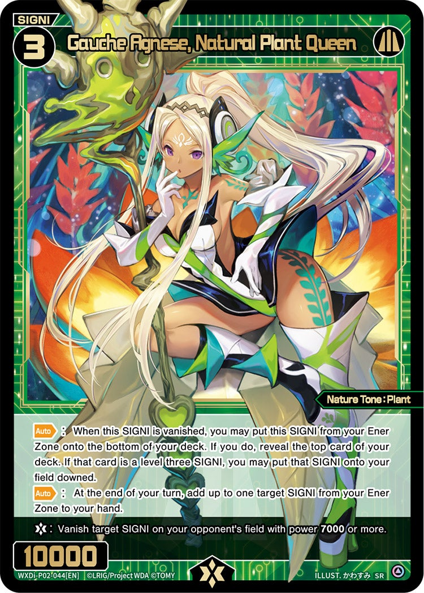

# Gauche Agnese, Natural Plant Queen

## Thông tin lá

| Trường | Giá trị |
| --- | --- |
| Mã in | WXDi-P02-044[EN] |
| Set | WXDi-P02[EN] |
| Số thứ tự | 044 |
| Loại thẻ | SIGNI |
| Vị trí | Main Deck |
| Số bản | — (set booster, không áp dụng) |
| Màu | Xanh lá |
| Độ hiếm | SR |
| Minh họa | かわすみ |
| Level | 3 |
| Limit | — |
| Power | 10000 |
| LRIG type / Class | Nature Tone：Plant |
| Team / Master | — |
| Cost | — |
| Grow cost | — |
| Use timing | — |
| Life Burst | Có |

## Card text chính thức

[Auto]: When this SIGNI is vanished, you may put this SIGNI from your Ener Zone onto the bottom of your deck. If you do, reveal the top card of your deck. If that card is a level three SIGNI, you may put that SIGNI onto your field downed.
[Auto]: At the end of your turn, add up to one target SIGNI from your Ener Zone to your hand.

## Power text / Life Burst

Vanish target SIGNI on your opponent's field with power 7000 or more.

## Ghi chú minh họa
Artist: かわすみ. Ảnh SR được tải từ Card List tiếng Anh.

## FAQ chính thức

**Q. If the upper Auto Ability reveals the top of the deck and it is not level 3 SIGNI.**
A. In that case, the effect ends. The revealed card is returned face down.

## Nguồn
[Card List/FAQ chính thức](https://www.takaratomy.co.jp/products/en.wixoss/card/card.html?card_no=WXDi-P02-044%5BEN%5D ) · [Ảnh thẻ](https://www.takaratomy.co.jp/products/en.wixoss/card/thumb/WXDi-P02-044%5BEN%5D.jpg)
