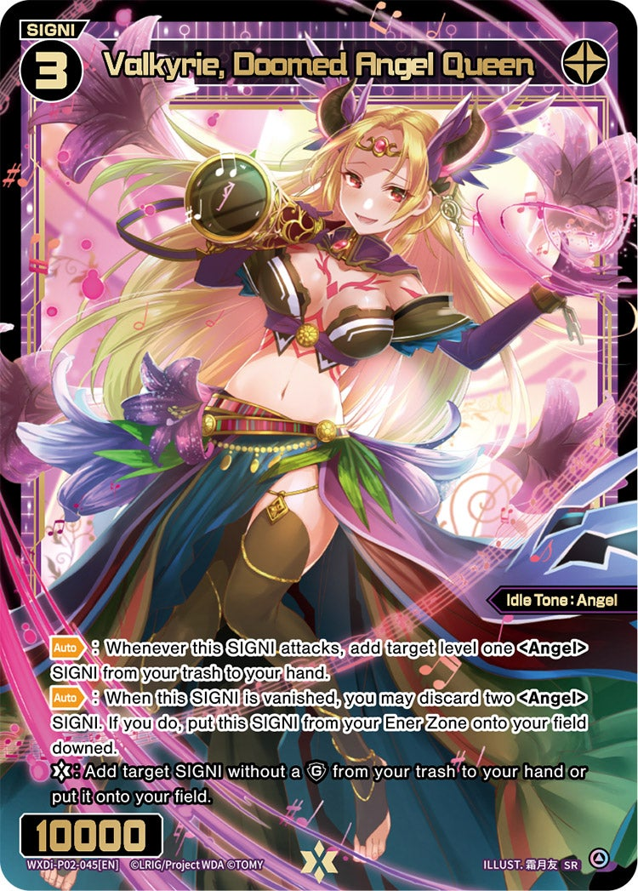

# Valkyrie, Doomed Angel Queen

## Thông tin lá

| Trường | Giá trị |
| --- | --- |
| Mã in | WXDi-P02-045[EN] |
| Set | WXDi-P02[EN] |
| Số thứ tự | 045 |
| Loại thẻ | SIGNI |
| Vị trí | Main Deck |
| Số bản | — (set booster, không áp dụng) |
| Màu | Đen |
| Độ hiếm | SR |
| Minh họa | 霜月友 |
| Level | 3 |
| Limit | — |
| Power | 10000 |
| LRIG type / Class | Idol Tone：Angel |
| Team / Master | — |
| Cost | — |
| Grow cost | — |
| Use timing | — |
| Life Burst | Có |

## Card text chính thức

[Auto]: Whenever this SIGNI attacks, add target level one <Angel> SIGNI from your trash to your hand.
[Auto]: When this SIGNI is vanished, you may discard two <Angel> SIGNI. If you do, put this SIGNI from your Ener Zone onto your field downed.

## Power text / Life Burst

Add target SIGNI without a {Guard Icon} from your trash to your hand or put it onto your field.

## Ghi chú minh họa
Artist: 霜月友. Ảnh SR được tải từ Card List tiếng Anh.

## FAQ chính thức

**Q. Is the upper Auto Ability target selection forced?**
A. Yes, Auto Ability that meets the condition is forced to Trigger.
Also, this ability is not marked "up to", so if there is a SIGNI that meets the condition, you must always target one of the SIGNI and add it to your hand.

## Nguồn
[Card List/FAQ chính thức](https://www.takaratomy.co.jp/products/en.wixoss/card/card.html?card_no=WXDi-P02-045%5BEN%5D ) · [Ảnh thẻ](https://www.takaratomy.co.jp/products/en.wixoss/card/thumb/WXDi-P02-045%5BEN%5D.jpg)
