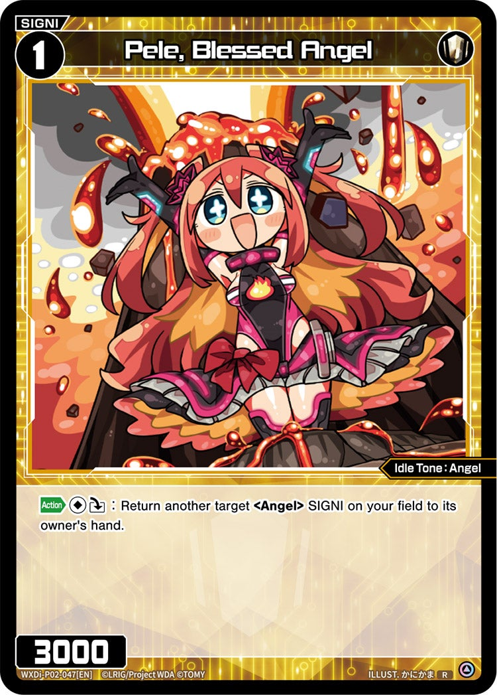

# Pele, Blessed Angel

## Thông tin lá

| Trường | Giá trị |
| --- | --- |
| Mã in | WXDi-P02-047[EN] |
| Set | WXDi-P02[EN] |
| Số thứ tự | 047 |
| Loại thẻ | SIGNI |
| Vị trí | Main Deck |
| Số bản | — (set booster, không áp dụng) |
| Màu | Trắng |
| Độ hiếm | R,R(P) |
| Minh họa | かにかま |
| Level | 1 |
| Limit | — |
| Power | 3000 |
| LRIG type / Class | Idol Tone：Angel |
| Team / Master | — |
| Cost | — |
| Grow cost | — |
| Use timing | — |
| Life Burst | Không |

## Card text chính thức

[Action] {Colorless} {Down}: Return another target <Angel> SIGNI on your field to its owner's hand.

## Power text / Life Burst

—

## Ghi chú minh họa
Artist: かにかま. Ảnh R được tải từ Card List tiếng Anh.

## FAQ chính thức

**Q. Can I target <Angel>SIGNI in the Trash or Ener Zone?**
A. No, you can't. Unless otherwise specified, the effect of selecting SIGNI is selected only from SIGNI on the field.

## Ảnh biến thể

- [R(P)](../images/WXDi-P02-047P-EN.jpg)

## Nguồn
[Card List/FAQ chính thức](https://www.takaratomy.co.jp/products/en.wixoss/card/card.html?card_no=WXDi-P02-047%5BEN%5D ) · [Ảnh thẻ](https://www.takaratomy.co.jp/products/en.wixoss/card/thumb/WXDi-P02-047%5BEN%5D.jpg)
