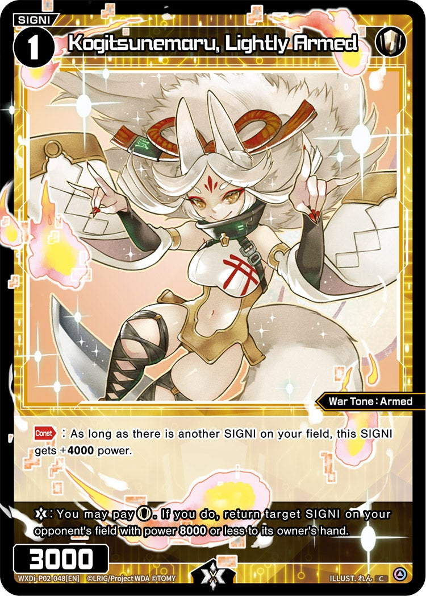

# Kogitsunemaru, Lightly Armed

## Thông tin lá

| Trường | Giá trị |
| --- | --- |
| Mã in | WXDi-P02-048[EN] |
| Set | WXDi-P02[EN] |
| Số thứ tự | 048 |
| Loại thẻ | SIGNI |
| Vị trí | Main Deck |
| Số bản | — (set booster, không áp dụng) |
| Màu | Trắng |
| Độ hiếm | C,C(P) |
| Minh họa | れん |
| Level | 1 |
| Limit | — |
| Power | 3000 |
| LRIG type / Class | War Tone：Armed |
| Team / Master | — |
| Cost | — |
| Grow cost | — |
| Use timing | — |
| Life Burst | Có |

## Card text chính thức

[Constant]: As long as there is another SIGNI on your field, this SIGNI gets +4000 power.

## Power text / Life Burst

You may pay {White}. If you do, return target SIGNI on your opponent's field with power 8000 or less to its owner's hand.

## Ghi chú minh họa
Artist: れん. Ảnh C được tải từ Card List tiếng Anh.

## FAQ chính thức

**Q. If only these two cards are on my field.**
A. Each will be +4000

## Ảnh biến thể

- [C(P)](../images/WXDi-P02-048P-EN.jpg)

## Nguồn
[Card List/FAQ chính thức](https://www.takaratomy.co.jp/products/en.wixoss/card/card.html?card_no=WXDi-P02-048%5BEN%5D ) · [Ảnh thẻ](https://www.takaratomy.co.jp/products/en.wixoss/card/thumb/WXDi-P02-048%5BEN%5D.jpg)
