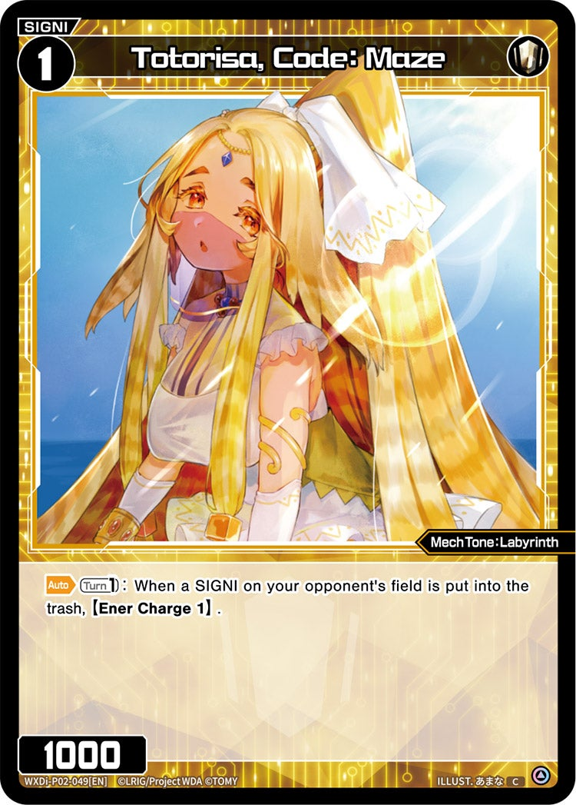

# Totorisa, Code: Maze

## Thông tin lá

| Trường | Giá trị |
| --- | --- |
| Mã in | WXDi-P02-049[EN] |
| Set | WXDi-P02[EN] |
| Số thứ tự | 049 |
| Loại thẻ | SIGNI |
| Vị trí | Main Deck |
| Số bản | — (set booster, không áp dụng) |
| Màu | Trắng |
| Độ hiếm | C,C(P) |
| Minh họa | あまな |
| Level | 1 |
| Limit | — |
| Power | 1000 |
| LRIG type / Class | Mech Tone：Labyrinth |
| Team / Master | — |
| Cost | — |
| Grow cost | — |
| Use timing | — |
| Life Burst | Không |

## Card text chính thức

[Auto] {1/Turn}: When a SIGNI on your opponent's field is put into the trash, 【Ener Charge 1】.

## Power text / Life Burst

—

## Ghi chú minh họa
Artist: あまな. Ảnh C được tải từ Card List tiếng Anh.

## FAQ chính thức

**Q. If an opponent Retires SIGNI, does Auto Ability Trigger?**
A. Yes, Auto Ability is triggered because SIGNI has been put on the trash by the opponent's "Retire".

## Ảnh biến thể

- [C(P)](../images/WXDi-P02-049P-EN.jpg)

## Nguồn
[Card List/FAQ chính thức](https://www.takaratomy.co.jp/products/en.wixoss/card/card.html?card_no=WXDi-P02-049%5BEN%5D ) · [Ảnh thẻ](https://www.takaratomy.co.jp/products/en.wixoss/card/thumb/WXDi-P02-049%5BEN%5D.jpg)
