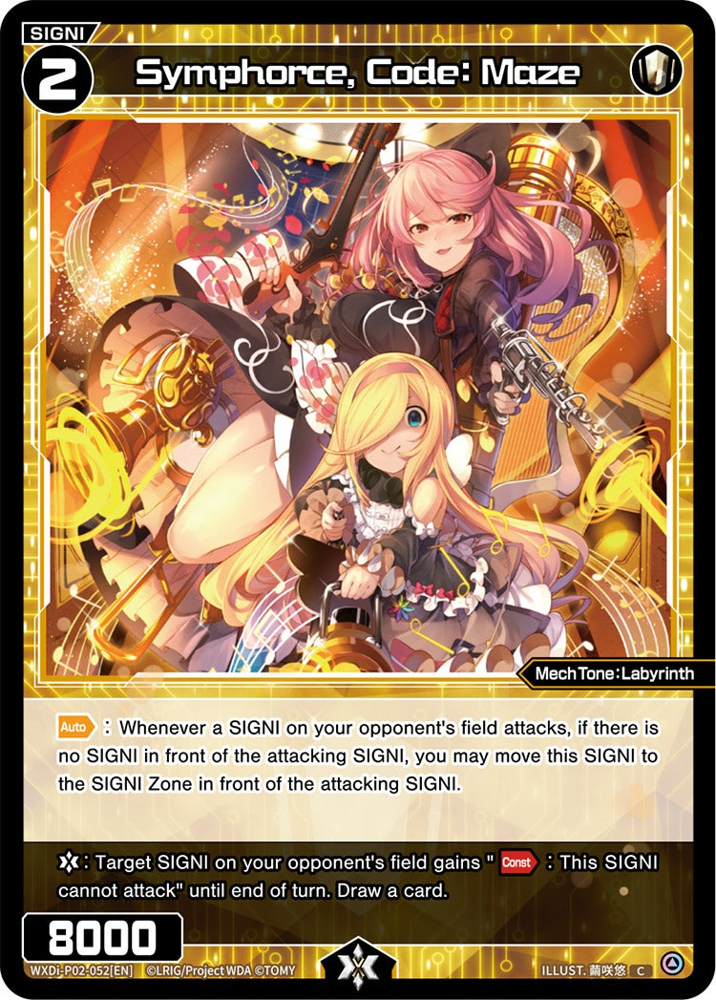

# Symphorce, Code: Maze

## Thông tin lá

| Trường | Giá trị |
| --- | --- |
| Mã in | WXDi-P02-052[EN] |
| Set | WXDi-P02[EN] |
| Số thứ tự | 052 |
| Loại thẻ | SIGNI |
| Vị trí | Main Deck |
| Số bản | — (set booster, không áp dụng) |
| Màu | Trắng |
| Độ hiếm | C,C(P) |
| Minh họa | 繭咲悠 |
| Level | 2 |
| Limit | — |
| Power | 8000 |
| LRIG type / Class | Mech Tone：Labyrinth |
| Team / Master | — |
| Cost | — |
| Grow cost | — |
| Use timing | — |
| Life Burst | Có |

## Card text chính thức

[Auto]: Whenever a SIGNI on your opponent's field attacks, if there is no SIGNI in front of the attacking SIGNI, you may move this SIGNI to the SIGNI Zone in front of the attacking SIGNI.

## Power text / Life Burst

Target SIGNI on your opponent's field gains "[Constant]: This SIGNI cannot attack" until end of turn. Draw a card.

## Ghi chú minh họa
Artist: 繭咲悠. Ảnh C được tải từ Card List tiếng Anh.

## FAQ chính thức

**Q. If Auto Ability is triggered and this SIGNI is moved in front of the attacking SIGNI, what happens then?**
A. This SIGNI battles with the attacking SIGNI.

## Ảnh biến thể

- [C(P)](../images/WXDi-P02-052P-EN.jpg)

## Nguồn
[Card List/FAQ chính thức](https://www.takaratomy.co.jp/products/en.wixoss/card/card.html?card_no=WXDi-P02-052%5BEN%5D ) · [Ảnh thẻ](https://www.takaratomy.co.jp/products/en.wixoss/card/thumb/WXDi-P02-052%5BEN%5D.jpg)
