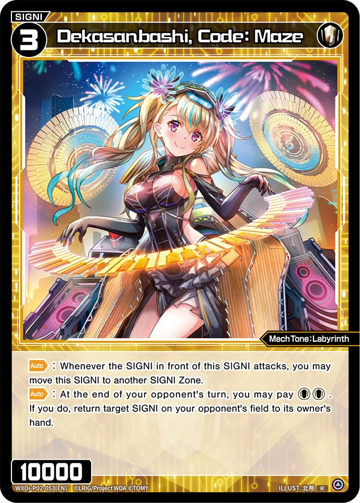

# Dekasanbashi, Code: Maze

## Thông tin lá

| Trường | Giá trị |
| --- | --- |
| Mã in | WXDi-P02-053[EN] |
| Set | WXDi-P02[EN] |
| Số thứ tự | 053 |
| Loại thẻ | SIGNI |
| Vị trí | Main Deck |
| Số bản | — (set booster, không áp dụng) |
| Màu | Trắng |
| Độ hiếm | R,R(P) |
| Minh họa | 北熊 |
| Level | 3 |
| Limit | — |
| Power | 10000 |
| LRIG type / Class | Mech Tone：Labyrinth |
| Team / Master | — |
| Cost | — |
| Grow cost | — |
| Use timing | — |
| Life Burst | Không |

## Card text chính thức

[Auto]: Whenever the SIGNI in front of this SIGNI attacks, you may move this SIGNI to another SIGNI Zone.
[Auto]: At the end of your opponent's turn, you may pay {White} {White}. If you do, return target SIGNI on your opponent's field to its owner's hand.

## Power text / Life Burst

—

## Ghi chú minh họa
Artist: 北熊. Ảnh R được tải từ Card List tiếng Anh.

## FAQ chính thức

**Q. If the SIGNI in front of this SIGNI attacks and places this SIGNI in another place.**
A. In that case, the "Dekasambashi" in front of the opponent's SIGNI has been placed to the other SIGNI zone, and there is no SIGNI in front of it. As a result, damage is dealt to you.

## Ảnh biến thể

- [R(P)](../images/WXDi-P02-053P-EN.jpg)

## Nguồn
[Card List/FAQ chính thức](https://www.takaratomy.co.jp/products/en.wixoss/card/card.html?card_no=WXDi-P02-053%5BEN%5D ) · [Ảnh thẻ](https://www.takaratomy.co.jp/products/en.wixoss/card/thumb/WXDi-P02-053%5BEN%5D.jpg)
