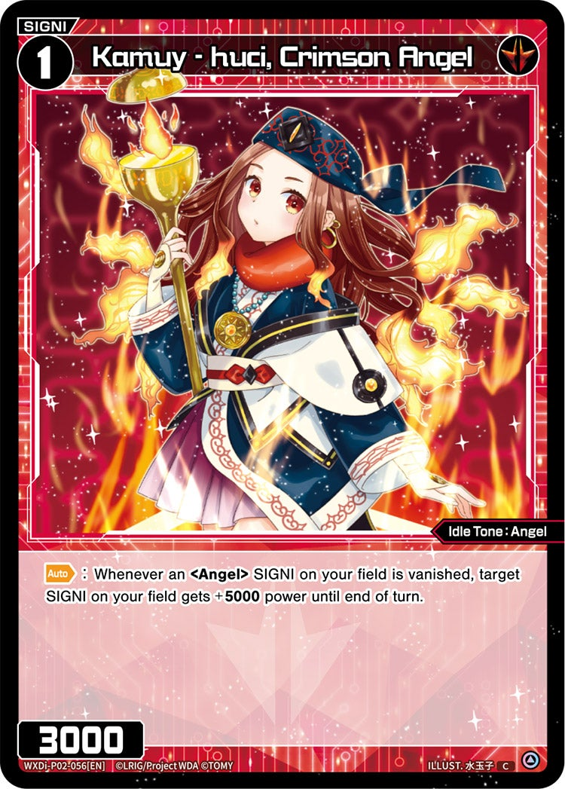

# Kamuy - huci, Crimson Angel

## Thông tin lá

| Trường | Giá trị |
| --- | --- |
| Mã in | WXDi-P02-056[EN] |
| Set | WXDi-P02[EN] |
| Số thứ tự | 056 |
| Loại thẻ | SIGNI |
| Vị trí | Main Deck |
| Số bản | — (set booster, không áp dụng) |
| Màu | Đỏ |
| Độ hiếm | C,C(P) |
| Minh họa | 水玉子 |
| Level | 1 |
| Limit | — |
| Power | 3000 |
| LRIG type / Class | Idol Tone：Angel |
| Team / Master | — |
| Cost | — |
| Grow cost | — |
| Use timing | — |
| Life Burst | Không |

## Card text chính thức

[Auto]: Whenever an <Angel> SIGNI on your field is vanished, target SIGNI on your field gets +5000 power until end of turn.

## Power text / Life Burst

—

## Ghi chú minh họa
Artist: 水玉子. Ảnh C được tải từ Card List tiếng Anh.

## FAQ chính thức

**Q. If this card itself is vanished.**
A. In this case, Yes, it triggers. 《Kamuy-huci》 is also your <Angel>'s SIGNI, so if it is vanished, the Auto Ability condition is met.

## Ảnh biến thể

- [C(P)](../images/WXDi-P02-056P-EN.jpg)

## Nguồn
[Card List/FAQ chính thức](https://www.takaratomy.co.jp/products/en.wixoss/card/card.html?card_no=WXDi-P02-056%5BEN%5D ) · [Ảnh thẻ](https://www.takaratomy.co.jp/products/en.wixoss/card/thumb/WXDi-P02-056%5BEN%5D.jpg)
