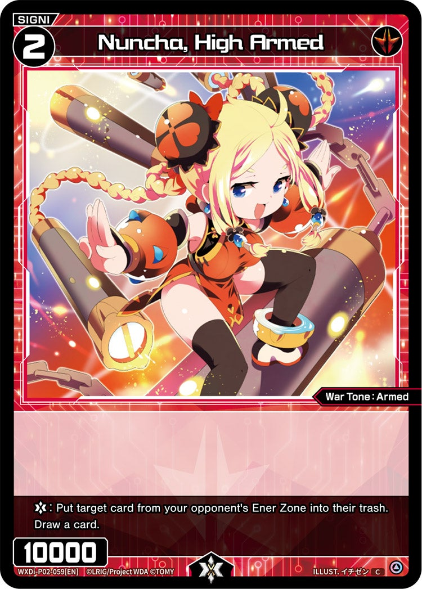

# Nuncha, High Armed

## Thông tin lá

| Trường | Giá trị |
| --- | --- |
| Mã in | WXDi-P02-059[EN] |
| Set | WXDi-P02[EN] |
| Số thứ tự | 059 |
| Loại thẻ | SIGNI |
| Vị trí | Main Deck |
| Số bản | — (set booster, không áp dụng) |
| Màu | Đỏ |
| Độ hiếm | C,C(P) |
| Minh họa | イチゼン |
| Level | 2 |
| Limit | — |
| Power | 10000 |
| LRIG type / Class | War Tone：Armed |
| Team / Master | — |
| Cost | — |
| Grow cost | — |
| Use timing | — |
| Life Burst | Có |

## Card text chính thức

—

## Power text / Life Burst

Put target card from your opponent's Ener Zone into their trash. Draw a card.

## Ghi chú minh họa
Artist: イチゼン. Ảnh C được tải từ Card List tiếng Anh.

## FAQ chính thức

**Q. Can I draw a card without cards in my opponent's Ener zone?**
A. Yes, you can draw a card.

## Ảnh biến thể

- [C(P)](../images/WXDi-P02-059P-EN.jpg)

## Nguồn
[Card List/FAQ chính thức](https://www.takaratomy.co.jp/products/en.wixoss/card/card.html?card_no=WXDi-P02-059%5BEN%5D ) · [Ảnh thẻ](https://www.takaratomy.co.jp/products/en.wixoss/card/thumb/WXDi-P02-059%5BEN%5D.jpg)
