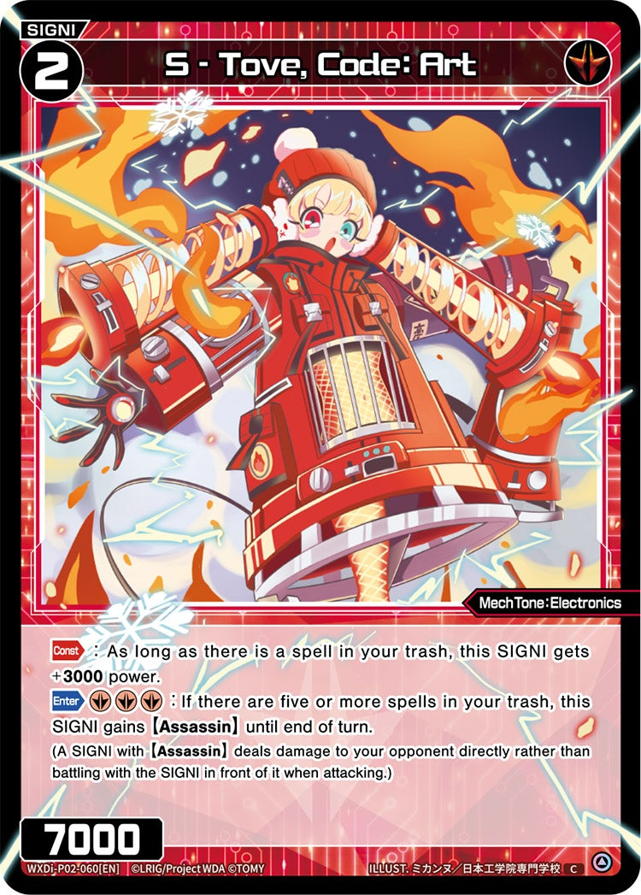

# S - Tove, Code: Art

## Thông tin lá

| Trường | Giá trị |
| --- | --- |
| Mã in | WXDi-P02-060[EN] |
| Set | WXDi-P02[EN] |
| Số thứ tự | 060 |
| Loại thẻ | SIGNI |
| Vị trí | Main Deck |
| Số bản | — (set booster, không áp dụng) |
| Màu | Đỏ |
| Độ hiếm | C,C(P) |
| Minh họa | ミカンヌ／日本工学院専門学校 |
| Level | 2 |
| Limit | — |
| Power | 7000 |
| LRIG type / Class | Mech Tone：Electronics |
| Team / Master | — |
| Cost | — |
| Grow cost | — |
| Use timing | — |
| Life Burst | Không |

## Card text chính thức

[Constant]: As long as there is a spell in your trash, this SIGNI gets +3000 power.
[Enter] {Red} {Red} {Red}: If there are five or more spells in your trash, this SIGNI gains 【Assassin】 until end of turn.
(A SIGNI with 【Assassin】 deals damage to your opponent directly rather than battling with the SIGNI in front of it when attacking.)

## Power text / Life Burst

—

## Ghi chú minh họa
Artist: ミカンヌ／日本工学院専門学校. Ảnh C được tải từ Card List tiếng Anh.

## FAQ chính thức

**Q. As a result of paying Enter Ability's cost {Red}{Red}{Red}, I have exactly 5 spells in my trash. Does this SIGNI gain [Assassin]?**
A. Yes, it will gain [Assassin]. This is because the counting of the number of spells in the trash is done after the cost is paid.

## Ảnh biến thể

- [C(P)](../images/WXDi-P02-060P-EN.jpg)

## Nguồn
[Card List/FAQ chính thức](https://www.takaratomy.co.jp/products/en.wixoss/card/card.html?card_no=WXDi-P02-060%5BEN%5D ) · [Ảnh thẻ](https://www.takaratomy.co.jp/products/en.wixoss/card/thumb/WXDi-P02-060%5BEN%5D.jpg)
