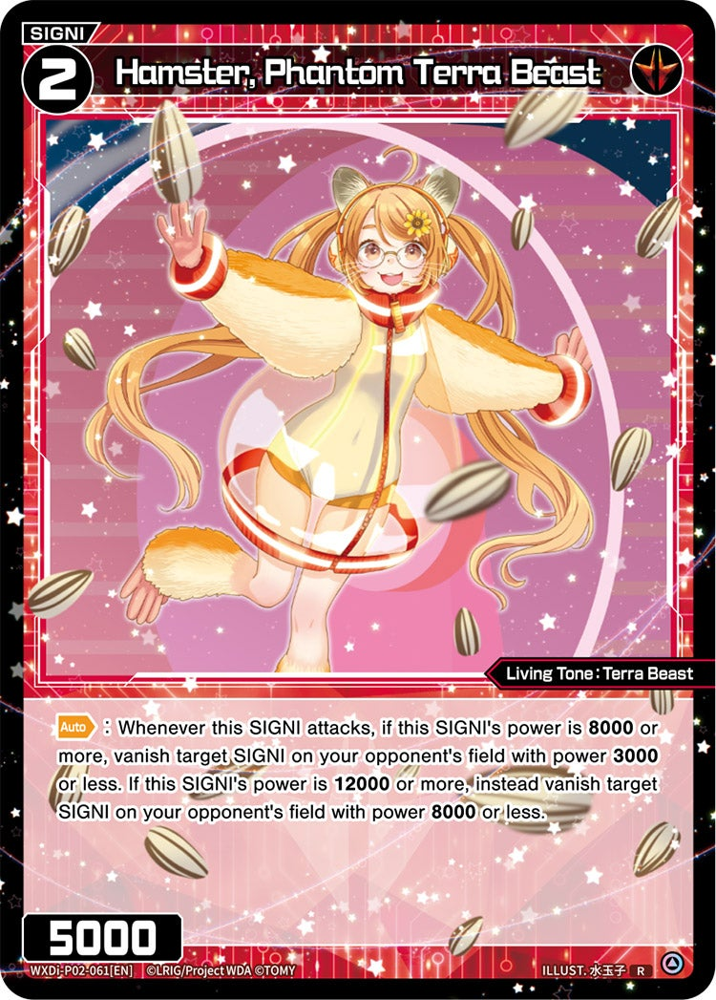

# Hamster, Phantom Terra Beast

## Thông tin lá

| Trường | Giá trị |
| --- | --- |
| Mã in | WXDi-P02-061[EN] |
| Set | WXDi-P02[EN] |
| Số thứ tự | 061 |
| Loại thẻ | SIGNI |
| Vị trí | Main Deck |
| Số bản | — (set booster, không áp dụng) |
| Màu | Đỏ |
| Độ hiếm | R,R(P) |
| Minh họa | 水玉子 |
| Level | 2 |
| Limit | — |
| Power | 5000 |
| LRIG type / Class | Living Tone：Terra Beast |
| Team / Master | — |
| Cost | — |
| Grow cost | — |
| Use timing | — |
| Life Burst | Không |

## Card text chính thức

[Auto]: Whenever this SIGNI attacks, if this SIGNI's power is 8000 or more, vanish target SIGNI on your opponent's field with power 3000 or less. If this SIGNI's power is 12000 or more, instead vanish target SIGNI on your opponent's field with power 8000 or less.

## Power text / Life Burst

—

## Ghi chú minh họa
Artist: 水玉子. Ảnh R được tải từ Card List tiếng Anh.

## FAQ chính thức

**Q. If this Auto Ability vanish the SIGNI in front of this SIGNI when it attacks. Does this attack can deal damage to my opponent?**
A. Yes, damage can be dealt. Auto ability triggered by attack is processed before the battle with SIGNI in front of it. If there is no SIGNI in front of it as a result of the process, the attacking SIGNI can deal damage to the opponent.

## Ảnh biến thể

- [R(P)](../images/WXDi-P02-061P-EN.jpg)

## Nguồn
[Card List/FAQ chính thức](https://www.takaratomy.co.jp/products/en.wixoss/card/card.html?card_no=WXDi-P02-061%5BEN%5D ) · [Ảnh thẻ](https://www.takaratomy.co.jp/products/en.wixoss/card/thumb/WXDi-P02-061%5BEN%5D.jpg)
