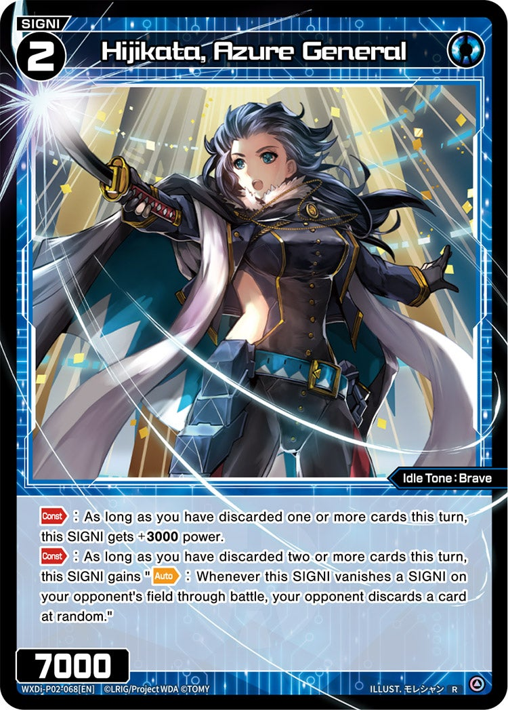

# Hijikata, Azure General

## Thông tin lá

| Trường | Giá trị |
| --- | --- |
| Mã in | WXDi-P02-068[EN] |
| Set | WXDi-P02[EN] |
| Số thứ tự | 068 |
| Loại thẻ | SIGNI |
| Vị trí | Main Deck |
| Số bản | — (set booster, không áp dụng) |
| Màu | Xanh dương |
| Độ hiếm | R,R(P) |
| Minh họa | モレシャン |
| Level | 2 |
| Limit | — |
| Power | 7000 |
| LRIG type / Class | Idol Tone：Brave |
| Team / Master | — |
| Cost | — |
| Grow cost | — |
| Use timing | — |
| Life Burst | Không |

## Card text chính thức

[Constant]: As long as you have discarded one or more cards this turn, this SIGNI gets +3000 power.
[Constant]: As long as you have discarded two or more cards this turn, this SIGNI gains "[Auto]: Whenever this SIGNI vanishes a SIGNI on your opponent's field through battle, your opponent discards a card at random."

## Power text / Life Burst

—

## Ghi chú minh họa
Artist: モレシャン. Ảnh R được tải từ Card List tiếng Anh.

## FAQ chính thức

**Q. Is this still +3000 during the opponent's turn?**
A. Yes, +3000 on either player's turn if the conditions are met.

## Ảnh biến thể

- [R(P)](../images/WXDi-P02-068P-EN.jpg)

## Nguồn
[Card List/FAQ chính thức](https://www.takaratomy.co.jp/products/en.wixoss/card/card.html?card_no=WXDi-P02-068%5BEN%5D ) · [Ảnh thẻ](https://www.takaratomy.co.jp/products/en.wixoss/card/thumb/WXDi-P02-068%5BEN%5D.jpg)
