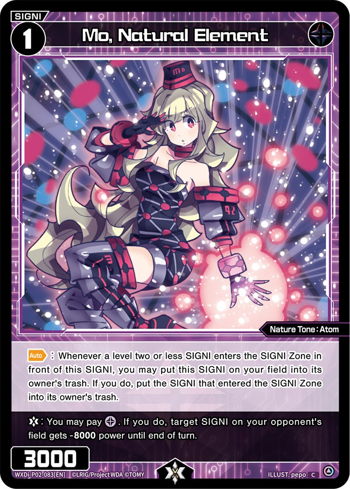

# Mo, Natural Element

## Thông tin lá

| Trường | Giá trị |
| --- | --- |
| Mã in | WXDi-P02-083[EN] |
| Set | WXDi-P02[EN] |
| Số thứ tự | 083 |
| Loại thẻ | SIGNI |
| Vị trí | Main Deck |
| Số bản | — (set booster, không áp dụng) |
| Màu | Đen |
| Độ hiếm | C,C(P) |
| Minh họa | pepo |
| Level | 1 |
| Limit | — |
| Power | 3000 |
| LRIG type / Class | Nature Tone：Atom |
| Team / Master | — |
| Cost | — |
| Grow cost | — |
| Use timing | — |
| Life Burst | Có |

## Card text chính thức

[Auto]: Whenever a level two or less SIGNI enters the SIGNI Zone in front of this SIGNI, you may put this SIGNI on your field into its owner's trash. If you do, put the SIGNI that entered the SIGNI Zone into its owner's trash.

## Power text / Life Burst

You may pay {Black}. If you do, target SIGNI on your opponent's field gets -8000 power until end of turn.

## Ghi chú minh họa
Artist: pepo. Ảnh C được tải từ Card List tiếng Anh.

## FAQ chính thức

— (không có FAQ riêng cho mã này trên trang FAQ tiếng Anh.)

## Ảnh biến thể

- [C(P)](../images/WXDi-P02-083P-EN.jpg)

## Nguồn
[Card List/FAQ chính thức](https://www.takaratomy.co.jp/products/en.wixoss/card/card.html?card_no=WXDi-P02-083%5BEN%5D ) · [Ảnh thẻ](https://www.takaratomy.co.jp/products/en.wixoss/card/thumb/WXDi-P02-083%5BEN%5D.jpg)
