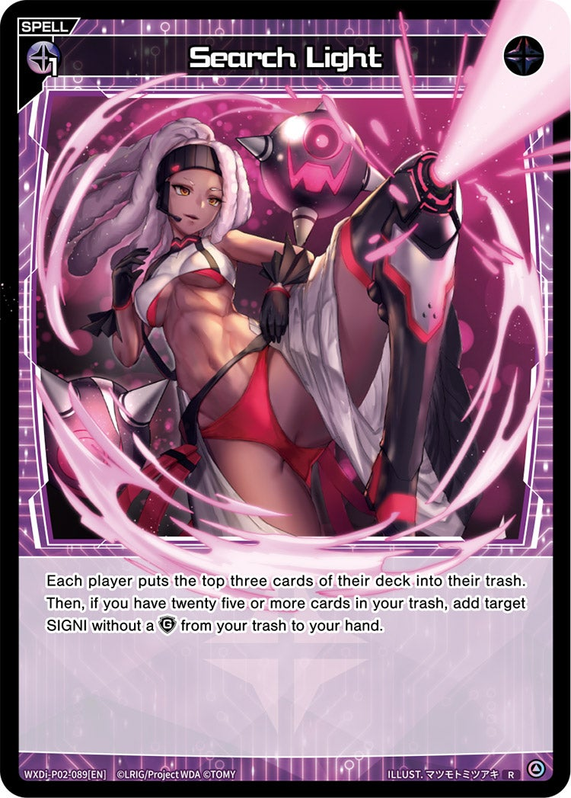

# Search Light

## Thông tin lá

| Trường | Giá trị |
| --- | --- |
| Mã in | WXDi-P02-089[EN] |
| Set | WXDi-P02[EN] |
| Số thứ tự | 089 |
| Loại thẻ | SPELL |
| Vị trí | Main Deck |
| Số bản | — (set booster, không áp dụng) |
| Màu | Đen |
| Độ hiếm | R,R(P) |
| Minh họa | マツモトミツアキ |
| Level | — |
| Limit | — |
| Power | 0 |
| LRIG type / Class | — |
| Team / Master | — |
| Cost | 《B》×１ |
| Grow cost | — |
| Use timing | — |
| Life Burst | Không |

## Card text chính thức

Each player puts the top three cards of their deck into their trash. Then, if you have twenty five or more cards in your trash, add target SIGNI without a {Guard Icon} from your trash to your hand.

## Power text / Life Burst

—

## Ghi chú minh họa
Artist: マツモトミツアキ. Ảnh R được tải từ Card List tiếng Anh.

## FAQ chính thức

— (không có FAQ riêng cho mã này trên trang FAQ tiếng Anh.)

## Ảnh biến thể

- [R(P)](../images/WXDi-P02-089P-EN.jpg)

## Nguồn
[Card List/FAQ chính thức](https://www.takaratomy.co.jp/products/en.wixoss/card/card.html?card_no=WXDi-P02-089%5BEN%5D ) · [Ảnh thẻ](https://www.takaratomy.co.jp/products/en.wixoss/card/thumb/WXDi-P02-089%5BEN%5D.jpg)
