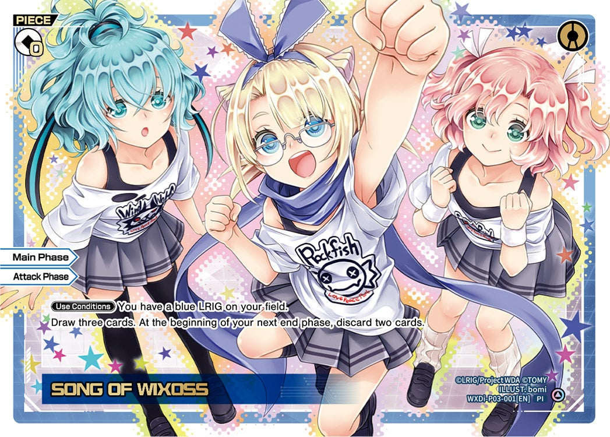

# SONG OF WIXOSS

## Thông tin lá

| Trường | Giá trị |
| --- | --- |
| Mã in | WXDi-P03-001[EN] |
| Set | WXDi-P03[EN] |
| Số thứ tự | 001 |
| Loại thẻ | PIECE |
| Vị trí | LRIG Deck |
| Số bản | — (set booster, không áp dụng) |
| Màu | Xanh dương |
| Độ hiếm | PI |
| Minh họa | bomi |
| Level | — |
| Limit | — |
| Power | 0 |
| LRIG type / Class | — |
| Team / Master | — |
| Cost | 《C》×０ |
| Grow cost | — |
| Use timing | Main Phase
Attack Phase |
| Life Burst | Không |

## Card text chính thức

[Use Conditions] You have a blue LRIG on your field.

Draw three cards. At the beginning of your next end phase, discard two cards.

## Power text / Life Burst

—

## Ghi chú minh họa
Artist: bomi. Ảnh PI được tải từ Card List tiếng Anh.

## FAQ chính thức

**Q. I used this PIECE in the Main Phase of my turn. What happens if I have 1 or less card in my hand at the end of that turn?**
A. If you have one card in your hand, you discard that card. If you have zero cards in your hand, nothing happens. Also, you do not discard again after your next turn.

**Q. If I use this PIECE in the Main Phase of my turn, when should I discard two cards in my hand?**
A. You discard two cards in your hand at the end of the turn you use it.

**Q. If I use this PIECE on my opponent's turn, when do I discard two cards in my hand?**
A. It will be at the end of your turn following your opponent's turn.

## Nguồn
[Card List/FAQ chính thức](https://www.takaratomy.co.jp/products/en.wixoss/card/card.html?card_no=WXDi-P03-001%5BEN%5D ) · [Ảnh thẻ](https://www.takaratomy.co.jp/products/en.wixoss/card/thumb/WXDi-P03-001%5BEN%5D.jpg)
