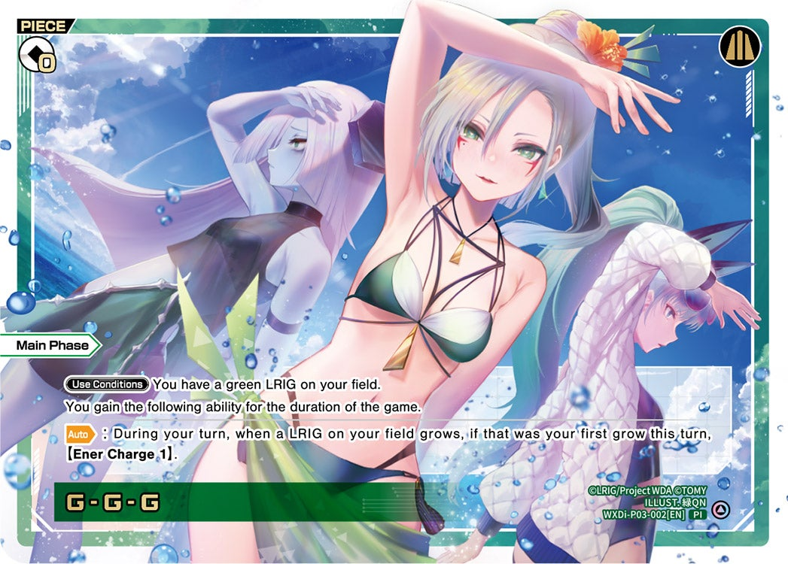

# G - G - G

## Thông tin lá

| Trường | Giá trị |
| --- | --- |
| Mã in | WXDi-P03-002[EN] |
| Set | WXDi-P03[EN] |
| Số thứ tự | 002 |
| Loại thẻ | PIECE |
| Vị trí | LRIG Deck |
| Số bản | — (set booster, không áp dụng) |
| Màu | Xanh lá |
| Độ hiếm | PI |
| Minh họa | 緑QN |
| Level | — |
| Limit | — |
| Power | 0 |
| LRIG type / Class | — |
| Team / Master | — |
| Cost | 《C》×０ |
| Grow cost | — |
| Use timing | Main Phase |
| Life Burst | Không |

## Card text chính thức

[Use Conditions] You have a green LRIG on your field.

You gain the following ability for the duration of the game.
『[Auto]: During your turn, when a LRIG on your field grows, if that was your first grow this turn, 【Ener Charge 1】.』

## Power text / Life Burst

—

## Ghi chú minh họa
Artist: 緑QN. Ảnh PI được tải từ Card List tiếng Anh.

## FAQ chính thức

**Q. Does this [Auto] ability trigger either for grow of center LRIG or GROW of assist LRIG?**
A. Yes, it is triggered in both cases.

## Nguồn
[Card List/FAQ chính thức](https://www.takaratomy.co.jp/products/en.wixoss/card/card.html?card_no=WXDi-P03-002%5BEN%5D ) · [Ảnh thẻ](https://www.takaratomy.co.jp/products/en.wixoss/card/thumb/WXDi-P03-002%5BEN%5D.jpg)
