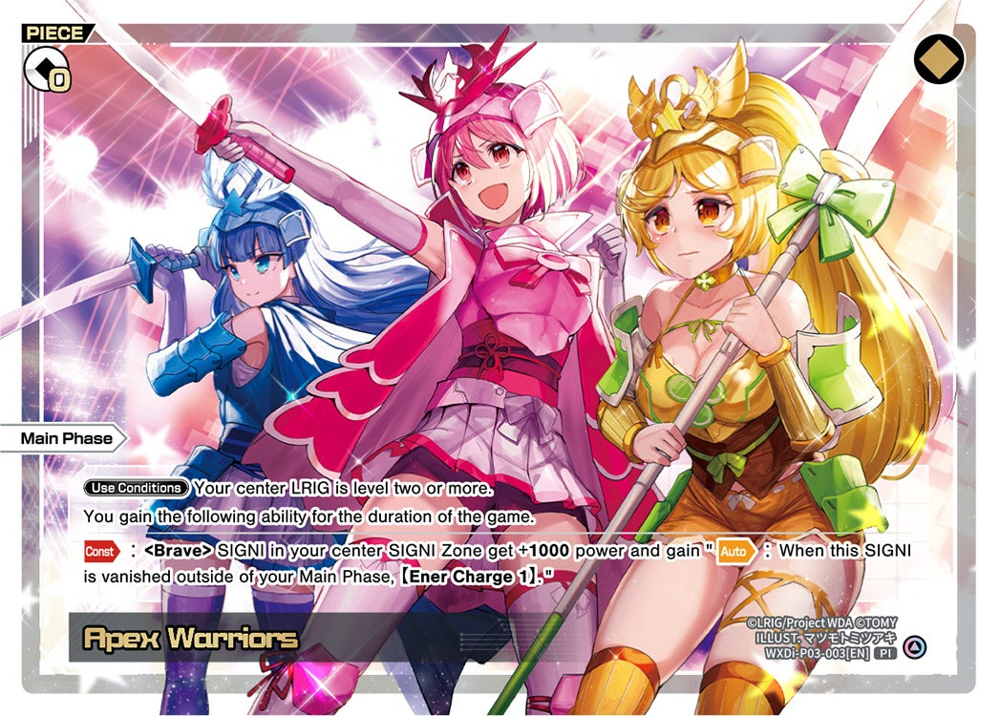

# Apex Warriors

## Thông tin lá

| Trường | Giá trị |
| --- | --- |
| Mã in | WXDi-P03-003[EN] |
| Set | WXDi-P03[EN] |
| Số thứ tự | 003 |
| Loại thẻ | PIECE |
| Vị trí | LRIG Deck |
| Số bản | — (set booster, không áp dụng) |
| Màu | Không màu |
| Độ hiếm | PI |
| Minh họa | マツモトミツアキ |
| Level | — |
| Limit | — |
| Power | 0 |
| LRIG type / Class | — |
| Team / Master | — |
| Cost | 《C》×０ |
| Grow cost | — |
| Use timing | Main Phase |
| Life Burst | Không |

## Card text chính thức

[Use Conditions] Your center LRIG is level two or more.

You gain the following ability for the duration of the game.
『[Constant]: <Brave> SIGNI in your center SIGNI Zone get +1000 power and gain "[Auto]: When this SIGNI is vanished outside of your Main Phase, 【Ener Charge 1】."』

## Power text / Life Burst

—

## Ghi chú minh họa
Artist: マツモトミツアキ. Ảnh PI được tải từ Card List tiếng Anh.

## FAQ chính thức

**Q. If I choose ①, what happens to the Life Cloth I looked at?**
A. Yes, this effect will make the <Brave>SIGNI gets +1000 power and ability even if it is a SIGNI of <Brave> that was put into the field later.

## Nguồn
[Card List/FAQ chính thức](https://www.takaratomy.co.jp/products/en.wixoss/card/card.html?card_no=WXDi-P03-003%5BEN%5D ) · [Ảnh thẻ](https://www.takaratomy.co.jp/products/en.wixoss/card/thumb/WXDi-P03-003%5BEN%5D.jpg)
