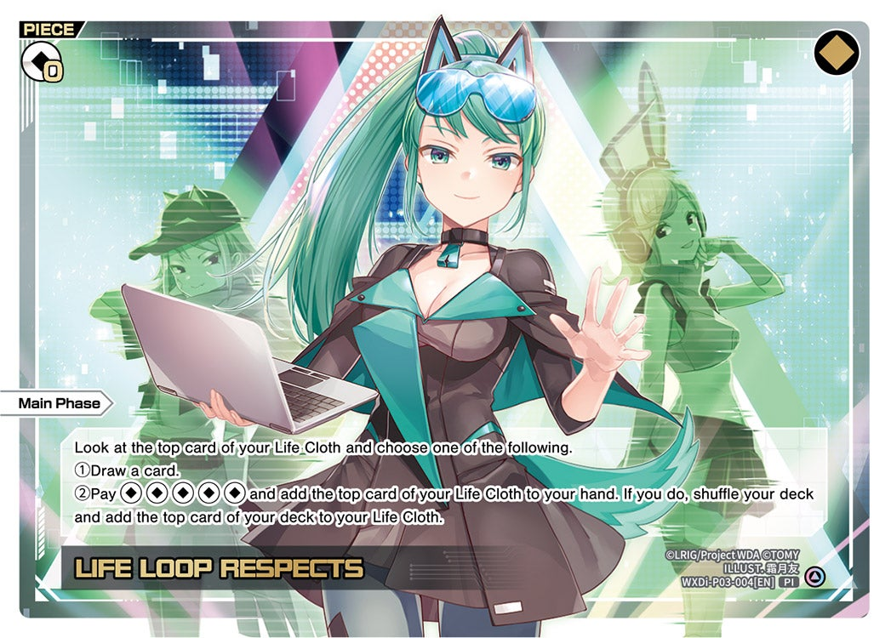

# LIFE LOOP RESPECTS

## Thông tin lá

| Trường | Giá trị |
| --- | --- |
| Mã in | WXDi-P03-004[EN] |
| Set | WXDi-P03[EN] |
| Số thứ tự | 004 |
| Loại thẻ | PIECE |
| Vị trí | LRIG Deck |
| Số bản | — (set booster, không áp dụng) |
| Màu | Không màu |
| Độ hiếm | PI |
| Minh họa | 霜月友 |
| Level | — |
| Limit | — |
| Power | 0 |
| LRIG type / Class | — |
| Team / Master | — |
| Cost | 《C》×０ |
| Grow cost | — |
| Use timing | Main Phase |
| Life Burst | Không |

## Card text chính thức

Look at the top card of your Life Cloth and choose one of the following.
①Draw a card.
②Pay {Colorless} {Colorless} {Colorless} {Colorless} {Colorless} and add the top card of your Life Cloth to your hand. If you do, shuffle your deck and add the top card of your deck to your Life Cloth.

## Power text / Life Burst

—

## Ghi chú minh họa
Artist: 霜月友. Ảnh PI được tải từ Card List tiếng Anh.

## FAQ chính thức

**Q. If I choose ①, what happens to the Life Cloth I looked at?**
A. You return it face down to the top of the Life Cloth as it is.

**Q. What happens if I chose ② and paid the Ener cost, but my Life Cloth is 0?**
A. If you have 0 Life Cloth, you cannot "add the top card of your Life Cloth to your hand", so the effects after "If you do" do not occur, and consequently nothing happens.

## Nguồn
[Card List/FAQ chính thức](https://www.takaratomy.co.jp/products/en.wixoss/card/card.html?card_no=WXDi-P03-004%5BEN%5D ) · [Ảnh thẻ](https://www.takaratomy.co.jp/products/en.wixoss/card/thumb/WXDi-P03-004%5BEN%5D.jpg)
