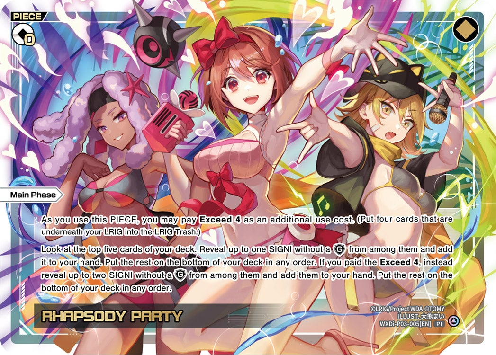

# RHAPSODY PARTY

## Thông tin lá

| Trường | Giá trị |
| --- | --- |
| Mã in | WXDi-P03-005[EN] |
| Set | WXDi-P03[EN] |
| Số thứ tự | 005 |
| Loại thẻ | PIECE |
| Vị trí | LRIG Deck |
| Số bản | — (set booster, không áp dụng) |
| Màu | Không màu |
| Độ hiếm | PI |
| Minh họa | 大熊まい |
| Level | — |
| Limit | — |
| Power | 0 |
| LRIG type / Class | — |
| Team / Master | — |
| Cost | 《C》×０ |
| Grow cost | — |
| Use timing | Main Phase |
| Life Burst | Không |

## Card text chính thức

As you use this PIECE, you may pay Exceed 4 as an additional use cost. (Put four cards that are underneath your LRIG into the LRIG Trash.)

Look at the top five cards of your deck. Reveal up to one SIGNI without a {Guard Icon} from among them and add it to your hand. Put the rest on the bottom of your deck in any order. If you paid the Exceed 4, instead reveal up to two SIGNI without a {Guard Icon} from among them and add them to your hand. Put the rest on the bottom of your deck in any order.

## Power text / Life Burst

—

## Ghi chú minh họa
Artist: 大熊まい. Ảnh PI được tải từ Card List tiếng Anh.

## FAQ chính thức

**Q. After looking at five cards from the top of the deck, can I decide to pay the Exceed cost and add two of them to my hand?**
A. No, you cannot. You pay the cost of Exceed when you use this card, which is before you see the five cards from the top of the deck.

**Q. What happens if I use this PIECE when I have 4 or less cards left in my deck?**
A. In that case, look at all four or fewer remaining cards in the deck and process the effect. If you returned one or more cards to your deck as resolving the effect, then no refresh is performed.

## Nguồn
[Card List/FAQ chính thức](https://www.takaratomy.co.jp/products/en.wixoss/card/card.html?card_no=WXDi-P03-005%5BEN%5D ) · [Ảnh thẻ](https://www.takaratomy.co.jp/products/en.wixoss/card/thumb/WXDi-P03-005%5BEN%5D.jpg)
