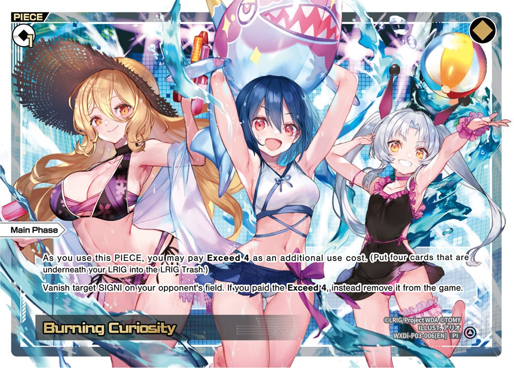

# Burning Curiosity

## Thông tin lá

| Trường | Giá trị |
| --- | --- |
| Mã in | WXDi-P03-006[EN] |
| Set | WXDi-P03[EN] |
| Số thứ tự | 006 |
| Loại thẻ | PIECE |
| Vị trí | LRIG Deck |
| Số bản | — (set booster, không áp dụng) |
| Màu | Không màu |
| Độ hiếm | PI |
| Minh họa | アリオ |
| Level | — |
| Limit | — |
| Power | 0 |
| LRIG type / Class | — |
| Team / Master | — |
| Cost | 《C》×１ |
| Grow cost | — |
| Use timing | Main Phase |
| Life Burst | Không |

## Card text chính thức

As you use this PIECE, you may pay Exceed 4 as an additional use cost. (Put four cards that are underneath your LRIG into the LRIG Trash.)

Vanish target SIGNI on your opponent's field. If you paid the Exceed 4, instead remove it from the game.

## Power text / Life Burst

—

## Ghi chú minh họa
Artist: アリオ. Ảnh PI được tải từ Card List tiếng Anh.

## FAQ chính thức

**Q. If I pay Exceed 4, can I select SIGNI placed in opponent's Ener Zone or Trash and remove it from the game?**
A. No, you cannot. If the effect targets SIGNI without specifying the zone, it can only target SIGNI that is on the field as SIGNI.

## Nguồn
[Card List/FAQ chính thức](https://www.takaratomy.co.jp/products/en.wixoss/card/card.html?card_no=WXDi-P03-006%5BEN%5D ) · [Ảnh thẻ](https://www.takaratomy.co.jp/products/en.wixoss/card/thumb/WXDi-P03-006%5BEN%5D.jpg)
