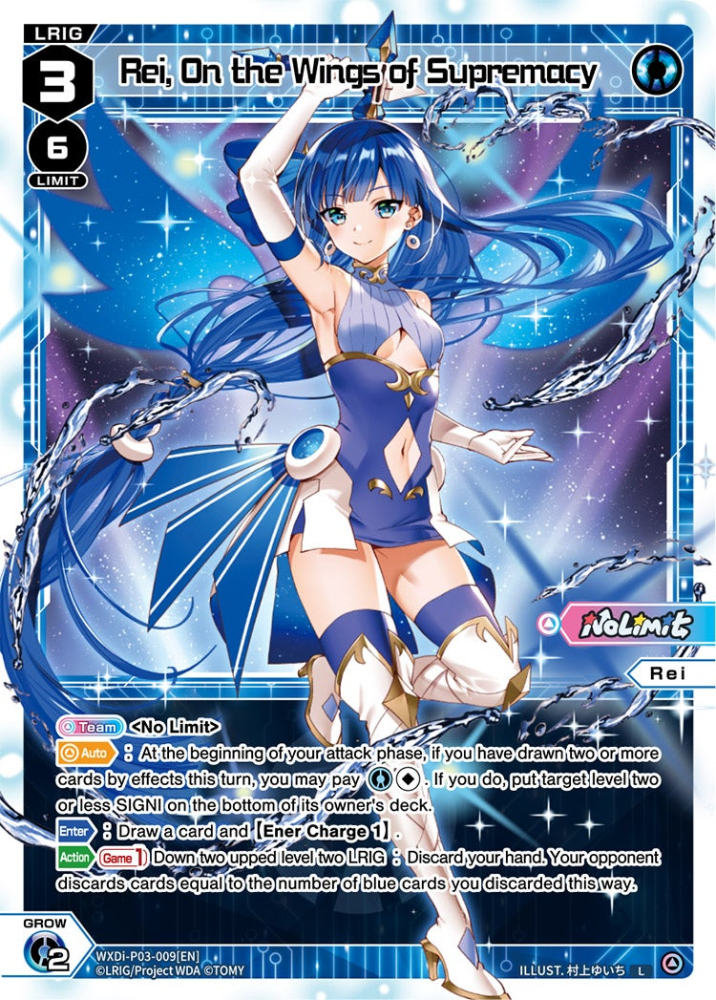

# Rei, On the Wings of Supremacy

## Thông tin lá

| Trường | Giá trị |
| --- | --- |
| Mã in | WXDi-P03-009[EN] |
| Set | WXDi-P03[EN] |
| Số thứ tự | 009 |
| Loại thẻ | LRIG |
| Vị trí | LRIG Deck |
| Số bản | — (set booster, không áp dụng) |
| Màu | Xanh dương |
| Độ hiếm | L,SCR,DiR |
| Minh họa | 村上ゆいち |
| Level | 3 |
| Limit | 6 |
| Power | 0 |
| LRIG type / Class | Rei |
| Team / Master | No Limit |
| Cost | — |
| Grow cost | 《U》×２ |
| Use timing | — |
| Life Burst | Không |

## Card text chính thức

[Team] <No Limit>
[Team Auto]: At the beginning of your attack phase, if you have drawn two or more cards by effects this turn, you may pay {Blue} {Colorless}. If you do, put target level two or less SIGNI on the bottom of its owner's deck.
[Enter]: Draw a card and 【Ener Charge 1】.
[Action] {1/Game} Down two upped level two LRIG: Discard your hand. Your opponent discards cards equal to the number of blue cards you discarded this way.

## Power text / Life Burst

—

## Ghi chú minh họa
Artist: 村上ゆいち. Ảnh L được tải từ Card List tiếng Anh.

## FAQ chính thức

**Q. What does it mean by [Team] icon?**
A. It means the team indicated by that card. The [Team Auto], [Team Action], [Team Constant], and [Team Enter] abilities of the card are valid only if all 3 LRIGs in your field are the indicated [Team].
In the case of this card, if all three of your LRIGs are <No Limit>, you will be able to use the [Team Auto] ability.

## Ảnh biến thể

- [DiR](../images/WXDi-P03-009D-EN.jpg)
- [SCR](../images/WXDi-P03-009S-EN.jpg)

## Nguồn
[Card List/FAQ chính thức](https://www.takaratomy.co.jp/products/en.wixoss/card/card.html?card_no=WXDi-P03-009%5BEN%5D ) · [Ảnh thẻ](https://www.takaratomy.co.jp/products/en.wixoss/card/thumb/WXDi-P03-009%5BEN%5D.jpg)
