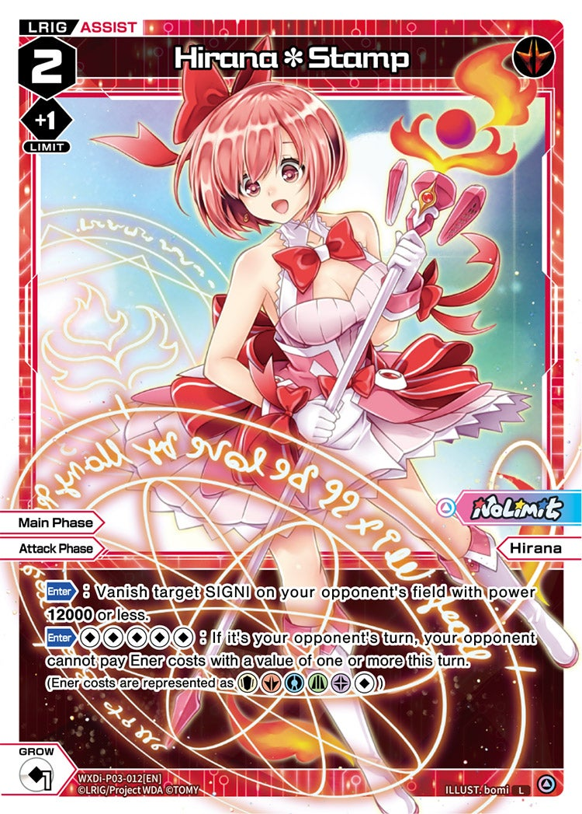

# Hirana*Stamp

## Thông tin lá

| Trường | Giá trị |
| --- | --- |
| Mã in | WXDi-P03-012[EN] |
| Set | WXDi-P03[EN] |
| Số thứ tự | 012 |
| Loại thẻ | ASSIST LRIG |
| Vị trí | LRIG Deck |
| Số bản | — (set booster, không áp dụng) |
| Màu | Đỏ |
| Độ hiếm | L,L(P) |
| Minh họa | bomi |
| Level | 2 |
| Limit | ＋1 |
| Power | 0 |
| LRIG type / Class | Hirana |
| Team / Master | No Limit |
| Cost | — |
| Grow cost | 《C》×１ |
| Use timing | Main Phase
Attack Phase |
| Life Burst | Không |

## Card text chính thức

[Enter]: Vanish target SIGNI on your opponent's field with power 12000 or less.
[Enter] {Colorless} {Colorless} {Colorless} {Colorless} {Colorless}: If it's your opponent's turn, your opponent cannot pay Ener costs with a value of one or more this turn.
(Ener costs are represented as {White} {Red} {Blue} {Green} {Black} {Colorless})

## Power text / Life Burst

—

## Ghi chú minh họa
Artist: bomi. Ảnh L được tải từ Card List tiếng Anh.

## FAQ chính thức

**Q. Is it possible to not use the [Enter] ability at the top?**
A. Yes, the no cost [Enter] ability is forced to activate. If there is a SIGNI with power 12000 or less on your opponent's field, you must activate the ability and vanish it, even if you do not want to vanish it.

**Q. If I activate the below [Enter] ability, can my opponent pay "White" x 0 or "Colorless" x 0 Ener cost?**
A. Yes, the opponent can pay since they are 0 Ener Cost.

## Ảnh biến thể

- [L(P)](../images/WXDi-P03-012P-EN.jpg)

## Nguồn
[Card List/FAQ chính thức](https://www.takaratomy.co.jp/products/en.wixoss/card/card.html?card_no=WXDi-P03-012%5BEN%5D ) · [Ảnh thẻ](https://www.takaratomy.co.jp/products/en.wixoss/card/thumb/WXDi-P03-012%5BEN%5D.jpg)
