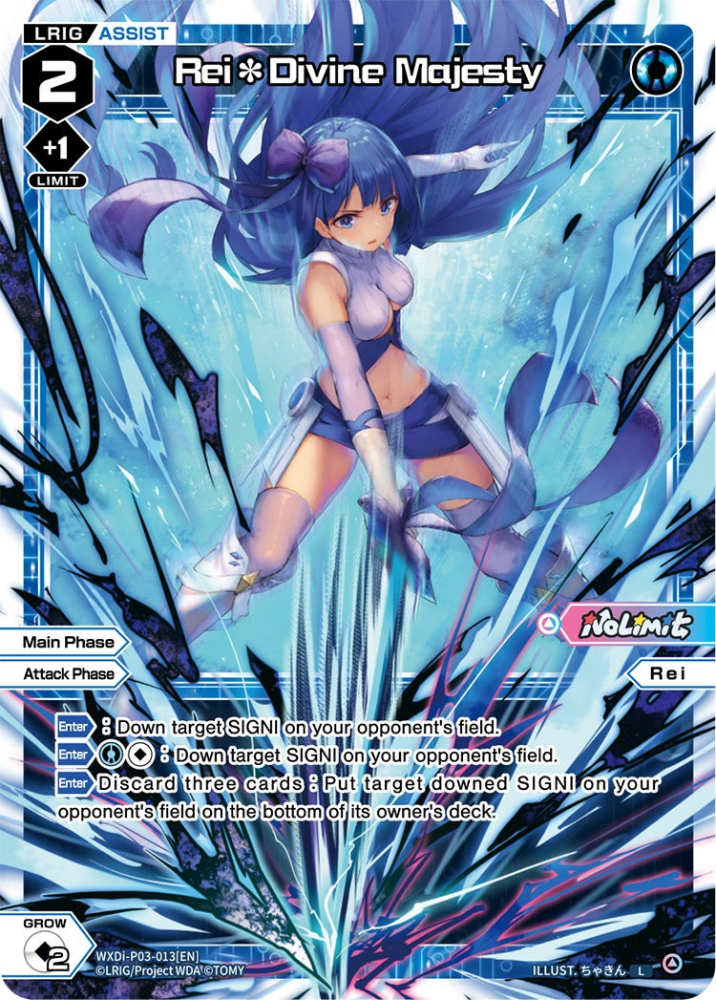

# Rei*Divine Majesty

## Thông tin lá

| Trường | Giá trị |
| --- | --- |
| Mã in | WXDi-P03-013[EN] |
| Set | WXDi-P03[EN] |
| Số thứ tự | 013 |
| Loại thẻ | ASSIST LRIG |
| Vị trí | LRIG Deck |
| Số bản | — (set booster, không áp dụng) |
| Màu | Xanh dương |
| Độ hiếm | L,L(P) |
| Minh họa | ちゃきん |
| Level | 2 |
| Limit | ＋1 |
| Power | 0 |
| LRIG type / Class | Rei |
| Team / Master | No Limit |
| Cost | — |
| Grow cost | 《C》×２ |
| Use timing | Main Phase
Attack Phase |
| Life Burst | Không |

## Card text chính thức

[Enter]: Down target SIGNI on your opponent's field.
[Enter] {Blue} {Colorless}: Down target SIGNI on your opponent's field.
[Enter] Discard three cards: Put target downed SIGNI on your opponent's field on the bottom of its owner's deck.

## Power text / Life Burst

—

## Ghi chú minh họa
Artist: ちゃきん. Ảnh L được tải từ Card List tiếng Anh.

## FAQ chính thức

**Q. After downing my opponent's SIGNI with the first and second [Enter] abilities, can I put it at the bottom of my opponent's deck with the third [Enter] ability?**
A. Yes, you can. Multiple Enter ability can be activated in any order, and the target is selected when the ability is activated, so in this case it is possible if you activate the above [Enter] ability first.

## Ảnh biến thể

- [L(P)](../images/WXDi-P03-013P-EN.jpg)

## Nguồn
[Card List/FAQ chính thức](https://www.takaratomy.co.jp/products/en.wixoss/card/card.html?card_no=WXDi-P03-013%5BEN%5D ) · [Ảnh thẻ](https://www.takaratomy.co.jp/products/en.wixoss/card/thumb/WXDi-P03-013%5BEN%5D.jpg)
