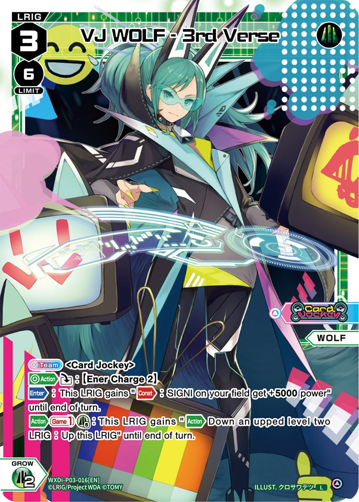

# VJ WOLF - 3rd Verse

## Thông tin lá

| Trường | Giá trị |
| --- | --- |
| Mã in | WXDi-P03-016[EN] |
| Set | WXDi-P03[EN] |
| Số thứ tự | 016 |
| Loại thẻ | LRIG |
| Vị trí | LRIG Deck |
| Số bản | — (set booster, không áp dụng) |
| Màu | Xanh lá |
| Độ hiếm | L,SCR,DiR |
| Minh họa | クロサワテツ |
| Level | 3 |
| Limit | 6 |
| Power | 0 |
| LRIG type / Class | WOLF |
| Team / Master | Card Jockey |
| Cost | — |
| Grow cost | 《G》×２ |
| Use timing | — |
| Life Burst | Không |

## Card text chính thức

[Team] <Card Jockey>
[Team Action] {Down}: 【Ener Charge 2】
[Enter]: This LRIG gains "[Constant]: SIGNI on your field get +5000 power" until end of turn.
[Action] {1/Game} {Greenx0}: This LRIG gains "[Action] Down an upped level two LRIG: Up this LRIG" until end of turn.

## Power text / Life Burst

—

## Ghi chú minh họa
Artist: クロサワテツ. Ảnh L được tải từ Card List tiếng Anh.

## FAQ chính thức

**Q. I put this LRIG onto the field and activate [Enter] ability. Does SIGNI that I put into the field after that LRIG also get +5000 in that turn?**
A. Yes, the [Constant] ability gained by this [Enter] ability also affects SIGNI that you put onto the field later that LRIG.

## Ảnh biến thể

- [DiR](../images/WXDi-P03-016D-EN.jpg)
- [SCR](../images/WXDi-P03-016S-EN.jpg)

## Nguồn
[Card List/FAQ chính thức](https://www.takaratomy.co.jp/products/en.wixoss/card/card.html?card_no=WXDi-P03-016%5BEN%5D ) · [Ảnh thẻ](https://www.takaratomy.co.jp/products/en.wixoss/card/thumb/WXDi-P03-016%5BEN%5D.jpg)
