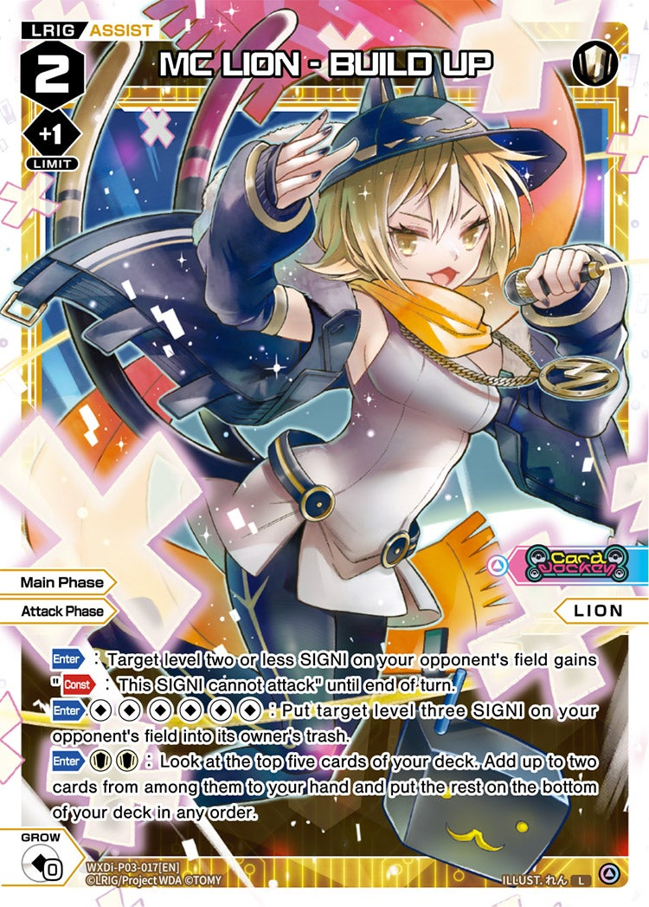

# MC LION - BUILD UP

## Thông tin lá

| Trường | Giá trị |
| --- | --- |
| Mã in | WXDi-P03-017[EN] |
| Set | WXDi-P03[EN] |
| Số thứ tự | 017 |
| Loại thẻ | ASSIST LRIG |
| Vị trí | LRIG Deck |
| Số bản | — (set booster, không áp dụng) |
| Màu | Trắng |
| Độ hiếm | L,L(P) |
| Minh họa | れん |
| Level | 2 |
| Limit | ＋1 |
| Power | 0 |
| LRIG type / Class | LION |
| Team / Master | Card Jockey |
| Cost | — |
| Grow cost | 《C》×０ |
| Use timing | Main Phase / Attack Phase |
| Life Burst | Không |

## Card text chính thức

[Enter]: Target level two or less SIGNI on your opponent's field gains "[Constant]: This SIGNI cannot attack" until end of turn.
[Enter] {Colorless} {Colorless} {Colorless} {Colorless} {Colorless} {Colorless}: Put target level three SIGNI on your opponent's field into its owner's trash.
[Enter] {White} {White}: Look at the top five cards of your deck. Add up to two cards from among them to your hand and put the rest on the bottom of your deck in any order.

## Power text / Life Burst

—

## Ghi chú minh họa
Artist: れん. Ảnh L được tải từ Card List tiếng Anh.

## FAQ chính thức

**Q. What happens if I use the bottom [Enter] ability when I have 4 or less cards left in my deck?**
A. In that case, look at all four or fewer remaining cards in the deck and process the effect. If you returned one or more cards to your deck as resolving the effect, then no refresh is performed.

## Ảnh biến thể

- [L(P)](../images/WXDi-P03-017P-EN.jpg)

## Nguồn
[Card List/FAQ chính thức](https://www.takaratomy.co.jp/products/en.wixoss/card/card.html?card_no=WXDi-P03-017%5BEN%5D ) · [Ảnh thẻ](https://www.takaratomy.co.jp/products/en.wixoss/card/thumb/WXDi-P03-017%5BEN%5D.jpg)
