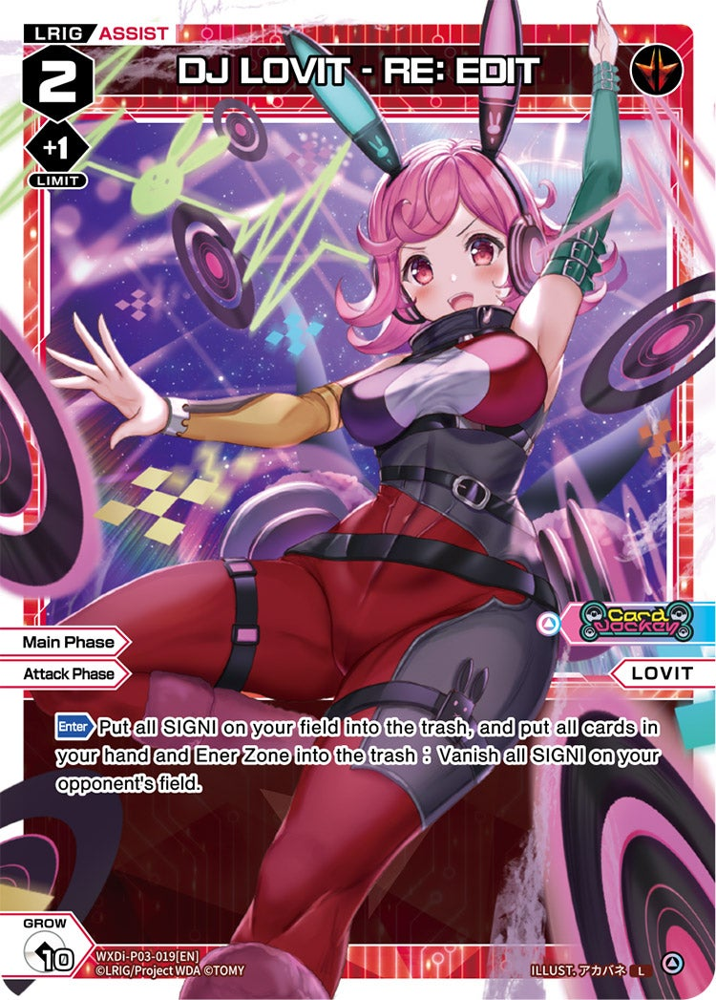

# DJ LOVIT - RE: EDIT

## Thông tin lá

| Trường | Giá trị |
| --- | --- |
| Mã in | WXDi-P03-019[EN] |
| Set | WXDi-P03[EN] |
| Số thứ tự | 019 |
| Loại thẻ | ASSIST LRIG |
| Vị trí | LRIG Deck |
| Số bản | — (set booster, không áp dụng) |
| Màu | Đỏ |
| Độ hiếm | L,L(P) |
| Minh họa | アカバネ |
| Level | 2 |
| Limit | ＋1 |
| Power | 0 |
| LRIG type / Class | LOVIT |
| Team / Master | Card Jockey |
| Cost | — |
| Grow cost | 《C》×１０ |
| Use timing | Main Phase / Attack Phase |
| Life Burst | Không |

## Card text chính thức

[Enter] Put all SIGNI on your field into the trash, and put all cards in your hand and Ener Zone into the trash: Vanish all SIGNI on your opponent's field.

## Power text / Life Burst

—

## Ghi chú minh họa
Artist: アカバネ. Ảnh L được tải từ Card List tiếng Anh.

## FAQ chính thức

**Q. When I pay the cost of [Enter] ability, do I also put cards in my opponent's hand and in the Ener Zone into the Trash?**
A. No, only your cards can be paid as cost, so you put all SIGNI in your field into Trash and all cards in your hand and your Ener Zone into Trash.

## Ảnh biến thể

- [L(P)](../images/WXDi-P03-019P-EN.jpg)

## Nguồn
[Card List/FAQ chính thức](https://www.takaratomy.co.jp/products/en.wixoss/card/card.html?card_no=WXDi-P03-019%5BEN%5D ) · [Ảnh thẻ](https://www.takaratomy.co.jp/products/en.wixoss/card/thumb/WXDi-P03-019%5BEN%5D.jpg)
