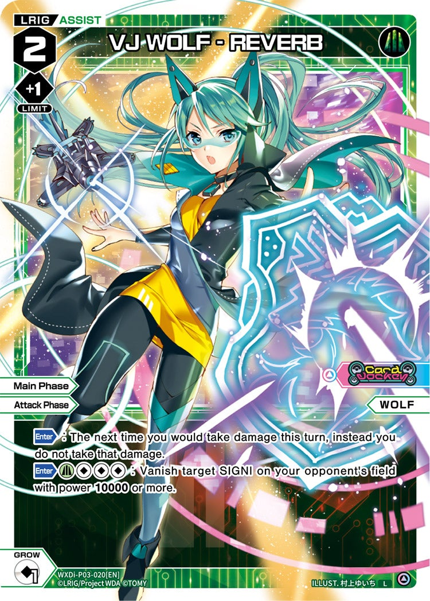

# VJ WOLF - REVERB

## Thông tin lá

| Trường | Giá trị |
| --- | --- |
| Mã in | WXDi-P03-020[EN] |
| Set | WXDi-P03[EN] |
| Số thứ tự | 020 |
| Loại thẻ | ASSIST LRIG |
| Vị trí | LRIG Deck |
| Số bản | — (set booster, không áp dụng) |
| Màu | Xanh lá |
| Độ hiếm | L,L(P) |
| Minh họa | 村上ゆいち |
| Level | 2 |
| Limit | ＋1 |
| Power | 0 |
| LRIG type / Class | WOLF |
| Team / Master | Card Jockey |
| Cost | — |
| Grow cost | 《C》×１ |
| Use timing | Main Phase
Attack Phase |
| Life Burst | Không |

## Card text chính thức

[Enter]: The next time you would take damage this turn, instead you do not take that damage.
[Enter] {Green} {Colorless} {Colorless} {Colorless}: Vanish target SIGNI on your opponent's field with power 10000 or more.

## Power text / Life Burst

—

## Ghi chú minh họa
Artist: 村上ゆいち. Ảnh L được tải từ Card List tiếng Anh.

## FAQ chính thức

— (không có FAQ riêng cho mã này trên trang FAQ tiếng Anh.)

## Ảnh biến thể

- [L(P)](../images/WXDi-P03-020P-EN.jpg)

## Nguồn
[Card List/FAQ chính thức](https://www.takaratomy.co.jp/products/en.wixoss/card/card.html?card_no=WXDi-P03-020%5BEN%5D ) · [Ảnh thẻ](https://www.takaratomy.co.jp/products/en.wixoss/card/thumb/WXDi-P03-020%5BEN%5D.jpg)
