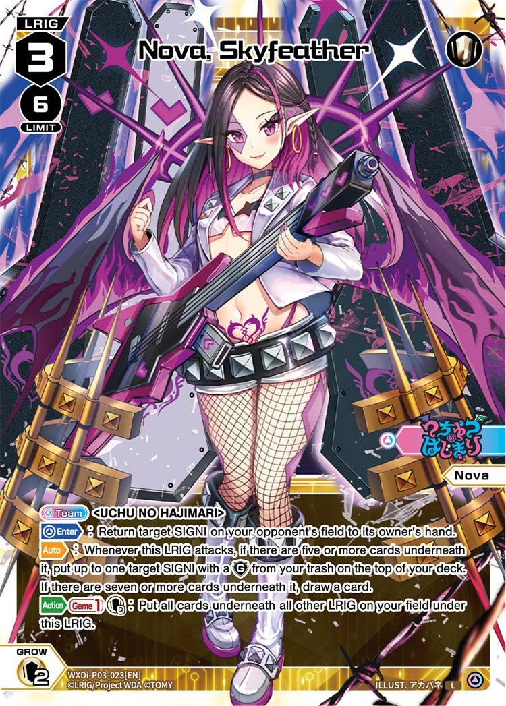

# Nova, Skyfeather

## Thông tin lá

| Trường | Giá trị |
| --- | --- |
| Mã in | WXDi-P03-023[EN] |
| Set | WXDi-P03[EN] |
| Số thứ tự | 023 |
| Loại thẻ | LRIG |
| Vị trí | LRIG Deck |
| Số bản | — (set booster, không áp dụng) |
| Màu | Trắng |
| Độ hiếm | L,SCR,DiR |
| Minh họa | アカバネ |
| Level | 3 |
| Limit | 6 |
| Power | 0 |
| LRIG type / Class | Nova |
| Team / Master | UCHU NO HAJIMARI |
| Cost | — |
| Grow cost | 《W》×２ |
| Use timing | — |
| Life Burst | Không |

## Card text chính thức

[Team] <UCHU NO HAJIMARI>
[Team Enter]: Return target SIGNI on your opponent's field to its owner's hand.
[Auto]: Whenever this LRIG attacks, if there are five or more cards underneath it, put up to one target SIGNI with a {Guard Icon} from your trash on the top of your deck. If there are seven or more cards underneath it, draw a card.
[Action] {1/Game} {Whitex0}: Put all cards underneath all other LRIG on your field under this LRIG.

## Power text / Life Burst

—

## Ghi chú minh họa
Artist: アカバネ. Ảnh L được tải từ Card List tiếng Anh.

## FAQ chính thức

**Q. When [Auto] ability is activated, if there are 7 or more cards under this LRIG, does it also trigger the effect of having 5 or more cards?**
A. Yes, both conditions are met, so both effects are processed. The effects are processed in order from the top, so the effect of having 5 or more cards is processed first, then the effect of having 7 or more cards is processed.

## Ảnh biến thể

- [DiR](../images/WXDi-P03-023D-EN.jpg)
- [SCR](../images/WXDi-P03-023S-EN.jpg)

## Nguồn
[Card List/FAQ chính thức](https://www.takaratomy.co.jp/products/en.wixoss/card/card.html?card_no=WXDi-P03-023%5BEN%5D ) · [Ảnh thẻ](https://www.takaratomy.co.jp/products/en.wixoss/card/thumb/WXDi-P03-023%5BEN%5D.jpg)
