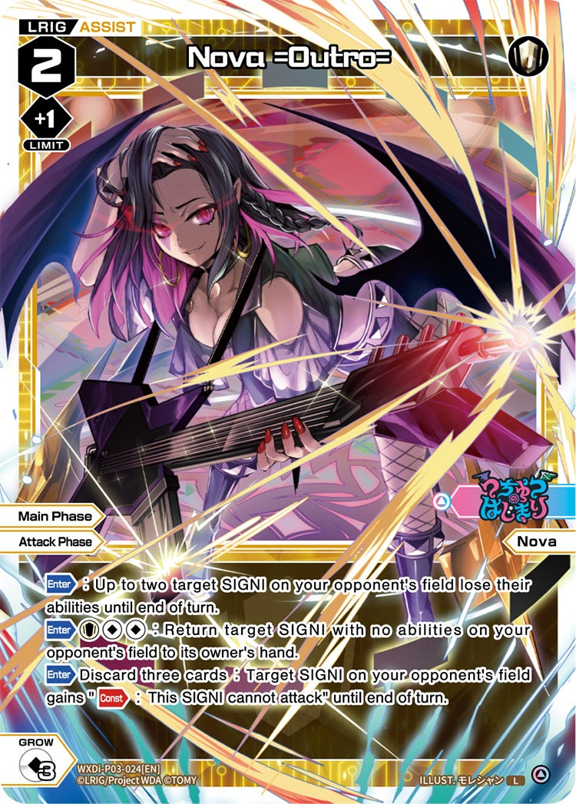

# Nova =Outro=

## Thông tin lá

| Trường | Giá trị |
| --- | --- |
| Mã in | WXDi-P03-024[EN] |
| Set | WXDi-P03[EN] |
| Số thứ tự | 024 |
| Loại thẻ | ASSIST LRIG |
| Vị trí | LRIG Deck |
| Số bản | — (set booster, không áp dụng) |
| Màu | Trắng |
| Độ hiếm | L,L(P) |
| Minh họa | モレシャン |
| Level | 2 |
| Limit | ＋1 |
| Power | 0 |
| LRIG type / Class | Nova |
| Team / Master | UCHU NO HAJIMARI |
| Cost | — |
| Grow cost | 《C》×３ |
| Use timing | Main Phase / Attack Phase |
| Life Burst | Không |

## Card text chính thức

[Enter]: Up to two target SIGNI on your opponent's field lose their abilities until end of turn.
[Enter] {White} {Colorless} {Colorless}: Return target SIGNI with no abilities on your opponent's field to its owner's hand.
[Enter] Discard three cards: Target SIGNI on your opponent's field gains "[Constant]: This SIGNI cannot attack" until end of turn.

## Power text / Life Burst

—

## Ghi chú minh họa
Artist: モレシャン. Ảnh L được tải từ Card List tiếng Anh.

## FAQ chính thức

**Q. What exactly do you mean by "SIGN with no abilities"?**
A. SIGNI with no information in the text box, SIGNI that has not gained any abilities due to the effects of other cards, and SIGNI that has lost abilities due to the effects of other cards are treated as "SIGNI with no abilities".

**Q. Can I make SIGNI lose its ability with the Enter ability above and return it to my hand with the second Enter ability?**
A. Yes, you can. Multiple [Enter] abilities can be activated in any order, and the target is selected when the ability is activated, so it is possible if the [Enter] ability above is activated first.

**Q. Is SIGNI with only Life Burst ability such as "Volcanic, Natural Crystal" SIGNI with no abilities?**
A. No, Life Burst is also an ability, so it is not treated as SIGNI with no abilities.

**Q. Is "Bronze, Natural Crystal" SIGNI with no ability?**
A. Yes, "Bronze, Natural Crystal" is SIGNI with no ability. The text box says (When paying costs, this card can be used as a red or blue), but the text enclosed in ( ) is an annotation and is not treated as an ability.

## Ảnh biến thể

- [L(P)](../images/WXDi-P03-024P-EN.jpg)

## Nguồn
[Card List/FAQ chính thức](https://www.takaratomy.co.jp/products/en.wixoss/card/card.html?card_no=WXDi-P03-024%5BEN%5D ) · [Ảnh thẻ](https://www.takaratomy.co.jp/products/en.wixoss/card/thumb/WXDi-P03-024%5BEN%5D.jpg)
