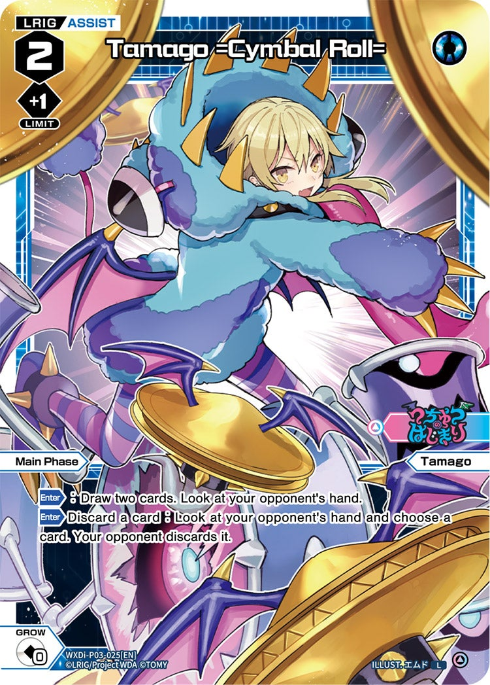

# Tamago =Cymbal Roll=

## Thông tin lá

| Trường | Giá trị |
| --- | --- |
| Mã in | WXDi-P03-025[EN] |
| Set | WXDi-P03[EN] |
| Số thứ tự | 025 |
| Loại thẻ | ASSIST LRIG |
| Vị trí | LRIG Deck |
| Số bản | — (set booster, không áp dụng) |
| Màu | Xanh dương |
| Độ hiếm | L,L(P) |
| Minh họa | エムド |
| Level | 2 |
| Limit | ＋1 |
| Power | 0 |
| LRIG type / Class | Tamago |
| Team / Master | UCHU NO HAJIMARI |
| Cost | — |
| Grow cost | 《C》×０ |
| Use timing | Main Phase |
| Life Burst | Không |

## Card text chính thức

[Enter]: Draw two cards. Look at your opponent's hand.
[Enter] Discard a card: Look at your opponent's hand and choose a card. Your opponent discards it.

## Power text / Life Burst

—

## Ghi chú minh họa
Artist: エムド. Ảnh L được tải từ Card List tiếng Anh.

## FAQ chính thức

**Q. I put this LRIG onto the field when I have 0 cards in my hand. Can I draw a card with the above Enter ability first, then discard it as a cost to activate the below Enter ability?**
A. Yes, you can.

**Q. After activating the above [Enter] ability and looking at my opponent's hand, then can I choose to whether activate the below [Enter] ability?**
A. Yes, it can. Multiple Enter abilities can be activated in any order, and you can choose not to pay and not to activate an [Enter] ability that has a cost, so you can activate the above [Enter] ability first and then decide whether to pay the cost of the below Enter ability.

## Ảnh biến thể

- [L(P)](../images/WXDi-P03-025P-EN.jpg)

## Nguồn
[Card List/FAQ chính thức](https://www.takaratomy.co.jp/products/en.wixoss/card/card.html?card_no=WXDi-P03-025%5BEN%5D ) · [Ảnh thẻ](https://www.takaratomy.co.jp/products/en.wixoss/card/thumb/WXDi-P03-025%5BEN%5D.jpg)
