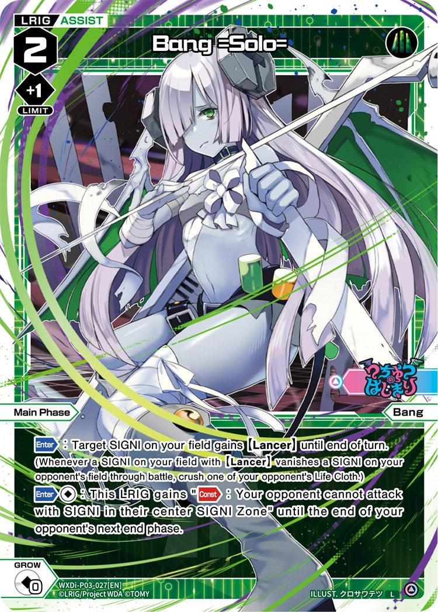

# Bang =Solo=

## Thông tin lá

| Trường | Giá trị |
| --- | --- |
| Mã in | WXDi-P03-027[EN] |
| Set | WXDi-P03[EN] |
| Số thứ tự | 027 |
| Loại thẻ | ASSIST LRIG |
| Vị trí | LRIG Deck |
| Số bản | — (set booster, không áp dụng) |
| Màu | Xanh lá |
| Độ hiếm | L,L(P) |
| Minh họa | クロサワテツ |
| Level | 2 |
| Limit | ＋1 |
| Power | 0 |
| LRIG type / Class | Bang |
| Team / Master | UCHU NO HAJIMARI |
| Cost | — |
| Grow cost | 《C》×０ |
| Use timing | Main Phase |
| Life Burst | Không |

## Card text chính thức

[Enter]: Target SIGNI on your field gains 【Lancer】 until end of turn.
(Whenever a SIGNI on your field with 【Lancer】 vanishes a SIGNI on your opponent's field through battle, crush one of your opponent's Life Cloth.)
[Enter] {Colorless}: This LRIG gains "[Constant]: Your opponent cannot attack with SIGNI in their center SIGNI Zone" until the end of your opponent's next end phase.

## Power text / Life Burst

—

## Ghi chú minh họa
Artist: クロサワテツ. Ảnh L được tải từ Card List tiếng Anh.

## FAQ chính thức

**Q. After activating the [Enter] ability below, a new SIGNI is put onto my opponent's center SIGNI Zone. Can that SIGNI attack?**
A. No, it cannot attack. This ability is a [Constant] ability that this LRIG gains, and does not give the SIGNI in your opponent's center SIGNI Zone the ability not to attack. Even if a SIGNI is put onto the SIGNI Zone later, the opponent cannot attack the SIGNI in that SIGNI Zone.

## Ảnh biến thể

- [L(P)](../images/WXDi-P03-027P-EN.jpg)

## Nguồn
[Card List/FAQ chính thức](https://www.takaratomy.co.jp/products/en.wixoss/card/card.html?card_no=WXDi-P03-027%5BEN%5D ) · [Ảnh thẻ](https://www.takaratomy.co.jp/products/en.wixoss/card/thumb/WXDi-P03-027%5BEN%5D.jpg)
