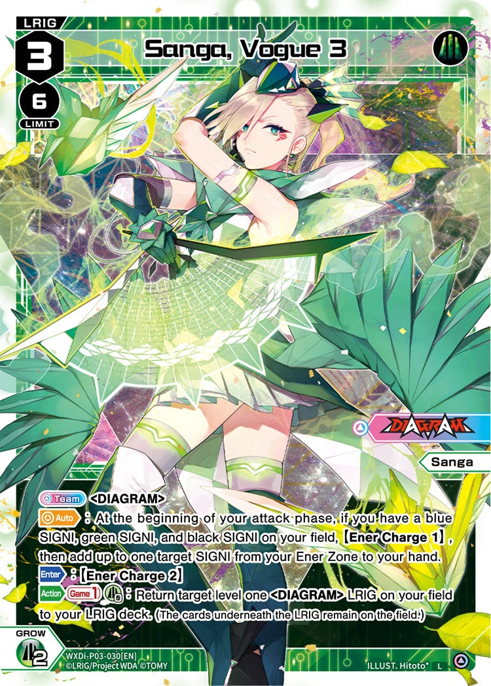

# Sanga, Vogue 3

## Thông tin lá

| Trường | Giá trị |
| --- | --- |
| Mã in | WXDi-P03-030[EN] |
| Set | WXDi-P03[EN] |
| Số thứ tự | 030 |
| Loại thẻ | LRIG |
| Vị trí | LRIG Deck |
| Số bản | — (set booster, không áp dụng) |
| Màu | Xanh lá |
| Độ hiếm | L,SCR,DiR |
| Minh họa | Hitoto* |
| Level | 3 |
| Limit | 6 |
| Power | 0 |
| LRIG type / Class | Sanga |
| Team / Master | DIAGRAM |
| Cost | — |
| Grow cost | 《G》×２ |
| Use timing | — |
| Life Burst | Không |

## Card text chính thức

[Team] <DIAGRAM>
[Team Auto]: At the beginning of your attack phase, if you have a blue SIGNI, green SIGNI, and black SIGNI on your field, 【Ener Charge 1】, then add up to one target SIGNI from your Ener Zone to your hand.
[Enter]: 【Ener Charge 2】
[Action] {1/Game} {Greenx0}: Return target level one <DIAGRAM> LRIG on your field to your LRIG deck. (The cards underneath the LRIG remain on the field.)

## Power text / Life Burst

—

## Ghi chú minh họa
Artist: Hitoto*. Ảnh L được tải từ Card List tiếng Anh.

## FAQ chính thức

**Q. I have a SIGNI with two colors (green and black) such as "Green Gas Type: Eins" and a blue SIGNI on my field, does this satisfy the [Auto] ability condition?**
A. Yes, in that case, the condition is still met because blue SIGNI, green SIGNI, and black SIGNI are on your field.

## Ảnh biến thể

- [DiR](../images/WXDi-P03-030D-EN.jpg)
- [SCR](../images/WXDi-P03-030S-EN.jpg)

## Nguồn
[Card List/FAQ chính thức](https://www.takaratomy.co.jp/products/en.wixoss/card/card.html?card_no=WXDi-P03-030%5BEN%5D ) · [Ảnh thẻ](https://www.takaratomy.co.jp/products/en.wixoss/card/thumb/WXDi-P03-030%5BEN%5D.jpg)
