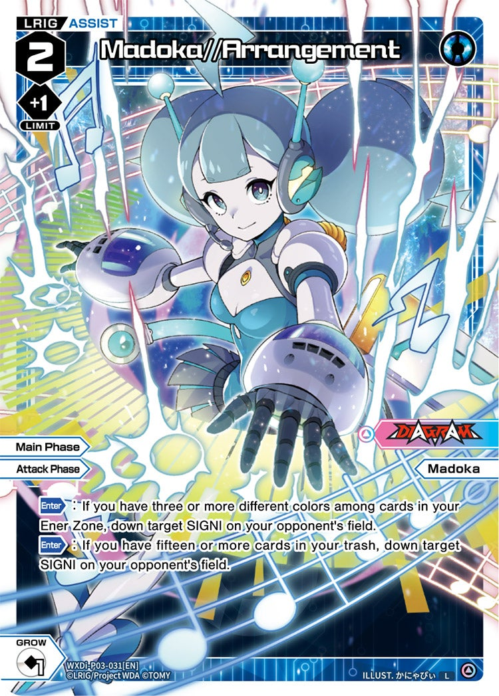

# Madoka//Arrangement

## Thông tin lá

| Trường | Giá trị |
| --- | --- |
| Mã in | WXDi-P03-031[EN] |
| Set | WXDi-P03[EN] |
| Số thứ tự | 031 |
| Loại thẻ | ASSIST LRIG |
| Vị trí | LRIG Deck |
| Số bản | — (set booster, không áp dụng) |
| Màu | Xanh dương |
| Độ hiếm | L,L(P) |
| Minh họa | かにゃぴぃ |
| Level | 2 |
| Limit | ＋1 |
| Power | 0 |
| LRIG type / Class | Madoka |
| Team / Master | DIAGRAM |
| Cost | — |
| Grow cost | 《C》×１ |
| Use timing | Main Phase
Attack Phase |
| Life Burst | Không |

## Card text chính thức

[Enter]: If you have three or more different colors among cards in your Ener Zone, down target SIGNI on your opponent's field.
[Enter]: If you have fifteen or more cards in your trash, down target SIGNI on your opponent's field.

## Power text / Life Burst

—

## Ghi chú minh họa
Artist: かにゃぴぃ. Ảnh L được tải từ Card List tiếng Anh.

## FAQ chính thức

**Q. Does a SIGNI with two colors, such as "Green Gas Type: Eins" count as two different color types?**
A. Yes, we count it. For example, "Green Gas Type: Eins" is green and black, so if there is another color in the Ener Zone, the above [Enter] ability condition is satisfied.

**Q. Is "Servant #" with [Multi Ener] counted as a color type in the Enter ability above?**
A. No, it is not counted. [Multi Ener] is the ability to pay Ener cost as one color of your choice, but it does not change the color of the card itself. Servant #" is colorless and is not counted as one of the colors.

## Ảnh biến thể

- [L(P)](../images/WXDi-P03-031P-EN.jpg)

## Nguồn
[Card List/FAQ chính thức](https://www.takaratomy.co.jp/products/en.wixoss/card/card.html?card_no=WXDi-P03-031%5BEN%5D ) · [Ảnh thẻ](https://www.takaratomy.co.jp/products/en.wixoss/card/thumb/WXDi-P03-031%5BEN%5D.jpg)
