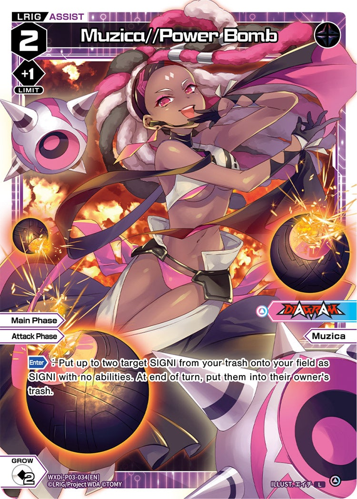

# Muzica//Power Bomb

## Thông tin lá

| Trường | Giá trị |
| --- | --- |
| Mã in | WXDi-P03-034[EN] |
| Set | WXDi-P03[EN] |
| Số thứ tự | 034 |
| Loại thẻ | ASSIST LRIG |
| Vị trí | LRIG Deck |
| Số bản | — (set booster, không áp dụng) |
| Màu | Đen |
| Độ hiếm | L,L(P) |
| Minh họa | エイチ |
| Level | 2 |
| Limit | ＋1 |
| Power | 0 |
| LRIG type / Class | Muzica |
| Team / Master | DIAGRAM |
| Cost | — |
| Grow cost | 《C》×２ |
| Use timing | Main Phase
Attack Phase |
| Life Burst | Không |

## Card text chính thức

[Enter]: Put up to two target SIGNI from your trash onto your field as SIGNI with no abilities. At end of turn, put them into their owner's trash.

## Power text / Life Burst

—

## Ghi chú minh họa
Artist: エイチ. Ảnh L được tải từ Card List tiếng Anh.

## FAQ chính thức

**Q. What happens when I put SIGNI with [Harmony] such as "Phalaris, Code: Ancients" into the field?**
A. [Harmony] is an ability that activates when it is put into the field, so if it is put into the field as SIGNI with no ability, it will not activate. You cannot Down the LRIG, but it will be put into the field in the Up state.

**Q. What happens if I put SIGNI with [Rise] into the field, such as "Anna Mirage, Doomed Evil"?**
A. Just before it is put onto the field, it is checked for conditions to put onto the field as SIGNI with ability, so it must be placed on top of SIGNI to meet the [Rise] condition.

## Ảnh biến thể

- [L(P)](../images/WXDi-P03-034P-EN.jpg)

## Nguồn
[Card List/FAQ chính thức](https://www.takaratomy.co.jp/products/en.wixoss/card/card.html?card_no=WXDi-P03-034%5BEN%5D ) · [Ảnh thẻ](https://www.takaratomy.co.jp/products/en.wixoss/card/thumb/WXDi-P03-034%5BEN%5D.jpg)
