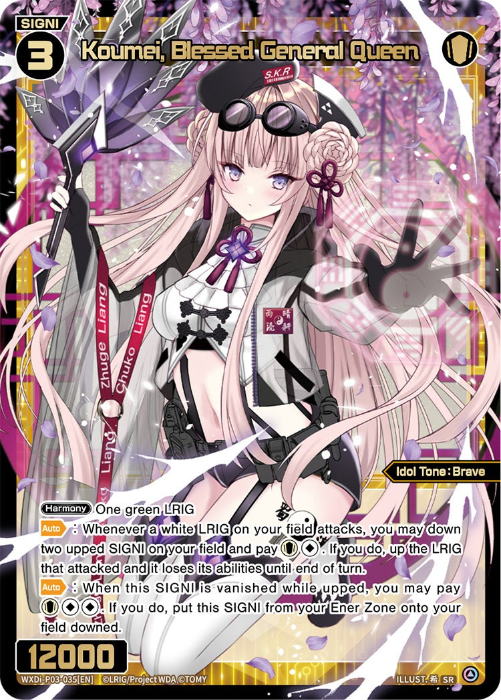

# Koumei, Blessed General Queen

## Thông tin lá

| Trường | Giá trị |
| --- | --- |
| Mã in | WXDi-P03-035[EN] |
| Set | WXDi-P03[EN] |
| Số thứ tự | 035 |
| Loại thẻ | SIGNI |
| Vị trí | Main Deck |
| Số bản | — (set booster, không áp dụng) |
| Màu | Trắng |
| Độ hiếm | SR |
| Minh họa | 希 |
| Level | 3 |
| Limit | — |
| Power | 12000 |
| LRIG type / Class | Idol Tone：Brave |
| Team / Master | — |
| Cost | — |
| Grow cost | — |
| Use timing | — |
| Life Burst | Không |

## Card text chính thức

[Harmony] One green LRIG
[Auto]: Whenever a white LRIG on your field attacks, you may down two upped SIGNI on your field and pay {White} {Colorless}. If you do, up the LRIG that attacked and it loses its abilities until end of turn.
[Auto]: When this SIGNI is vanished while upped, you may pay {White} {Colorless} {Colorless}. If you do, put this SIGNI from your Ener Zone onto your field downed.

## Power text / Life Burst

—

## Ghi chú minh họa
Artist: 希. Ảnh SR được tải từ Card List tiếng Anh.

## FAQ chính thức

**Q. This upped SIGNI is vanished and the [Auto] ability below is activated. Can I pay for this SIGNI that was vanished as the cost of "White", "Colorless", and "Colorless"?**
A. You can pay it, but since it is an ability to put it onto the field from the Ener Zone, this SIGNI placed on the Trash will not return to the field.

## Nguồn
[Card List/FAQ chính thức](https://www.takaratomy.co.jp/products/en.wixoss/card/card.html?card_no=WXDi-P03-035%5BEN%5D ) · [Ảnh thẻ](https://www.takaratomy.co.jp/products/en.wixoss/card/thumb/WXDi-P03-035%5BEN%5D.jpg)
