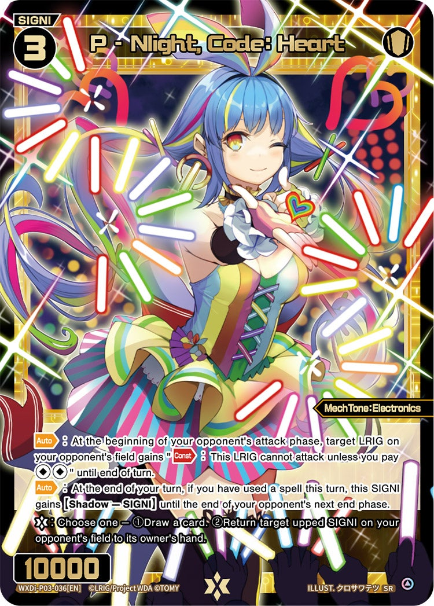

# P-Nlight, Code: Heart

## Thông tin lá

| Trường | Giá trị |
| --- | --- |
| Mã in | WXDi-P03-036[EN] |
| Set | WXDi-P03[EN] |
| Số thứ tự | 036 |
| Loại thẻ | SIGNI |
| Vị trí | Main Deck |
| Số bản | — (set booster, không áp dụng) |
| Màu | Trắng |
| Độ hiếm | SR |
| Minh họa | クロサワテツ |
| Level | 3 |
| Limit | — |
| Power | 10000 |
| LRIG type / Class | Mech Tone：Electronics |
| Team / Master | — |
| Cost | — |
| Grow cost | — |
| Use timing | — |
| Life Burst | Có |

## Card text chính thức

[Auto]: At the beginning of your opponent's attack phase, target LRIG on your opponent's field gains "[Constant]: This LRIG cannot attack unless you pay {Colorless} {Colorless}" until end of turn.
[Auto]: At the end of your turn, if you have used a spell this turn, this SIGNI gains 【Shadow — SIGNI】 until the end of your opponent's next end phase.

## Power text / Life Burst

Choose one — ①Draw a card. ②Return target upped SIGNI on your opponent's field to its owner's hand.

## Ghi chú minh họa
Artist: クロサワテツ. Ảnh SR được tải từ Card List tiếng Anh.

## FAQ chính thức

**Q. Is the [Shadow (SIGNI)] ability no longer targeted by a SIGNI's Life Burst ability?**
A. Yes, Life Burst can also be prevented from being targeted by this ability if it is SIGNI.

## Nguồn
[Card List/FAQ chính thức](https://www.takaratomy.co.jp/products/en.wixoss/card/card.html?card_no=WXDi-P03-036%5BEN%5D ) · [Ảnh thẻ](https://www.takaratomy.co.jp/products/en.wixoss/card/thumb/WXDi-P03-036%5BEN%5D.jpg)
