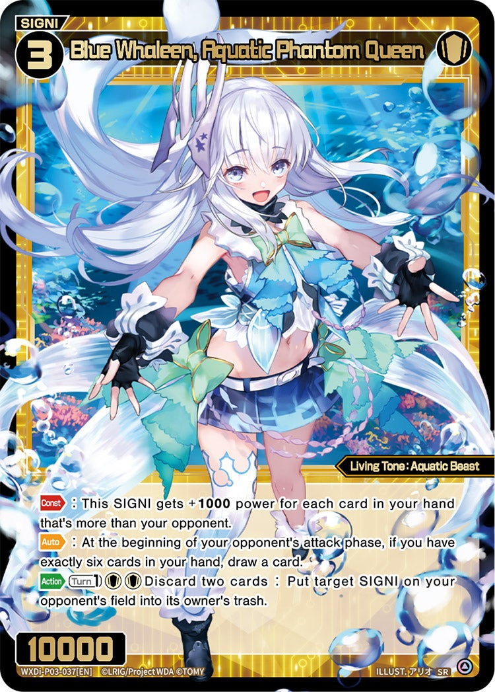

# Blue Whaleen, Aquatic Phantom Queen

## Thông tin lá

| Trường | Giá trị |
| --- | --- |
| Mã in | WXDi-P03-037[EN] |
| Set | WXDi-P03[EN] |
| Số thứ tự | 037 |
| Loại thẻ | SIGNI |
| Vị trí | Main Deck |
| Số bản | — (set booster, không áp dụng) |
| Màu | Trắng |
| Độ hiếm | SR |
| Minh họa | アリオ |
| Level | 3 |
| Limit | — |
| Power | 10000 |
| LRIG type / Class | Living Tone：Aquatic Beast |
| Team / Master | — |
| Cost | — |
| Grow cost | — |
| Use timing | — |
| Life Burst | Không |

## Card text chính thức

[Constant]: This SIGNI gets +1000 power for each card in your hand that's more than your opponent.
[Auto]: At the beginning of your opponent's attack phase, if you have exactly six cards in your hand, draw a card.
[Action] {1/Turn} {White} {White} Discard two cards: Put target SIGNI on your opponent's field into its owner's trash.

## Power text / Life Burst

—

## Ghi chú minh họa
Artist: アリオ. Ảnh SR được tải từ Card List tiếng Anh.

## FAQ chính thức

**Q. I have 2 "Blue Whaleen Aquatic Phantom Queen" in my field and I have 6 cards in my hand. How many cards can I draw at the beginning of your opponent's Attack phase?**
A. You can draw 1 card. At the beginning of your opponent's Attack phase, the [Auto] abilities of the two "Blue Whaleen Aquatic Phantom Queen" are triggered, and you deal with them in order; after activating the first one, you draw a card and have 7 cards in your hand, so at the time of activating the second one, the condition is not met and you cannot draw a card.

## Nguồn
[Card List/FAQ chính thức](https://www.takaratomy.co.jp/products/en.wixoss/card/card.html?card_no=WXDi-P03-037%5BEN%5D ) · [Ảnh thẻ](https://www.takaratomy.co.jp/products/en.wixoss/card/thumb/WXDi-P03-037%5BEN%5D.jpg)
