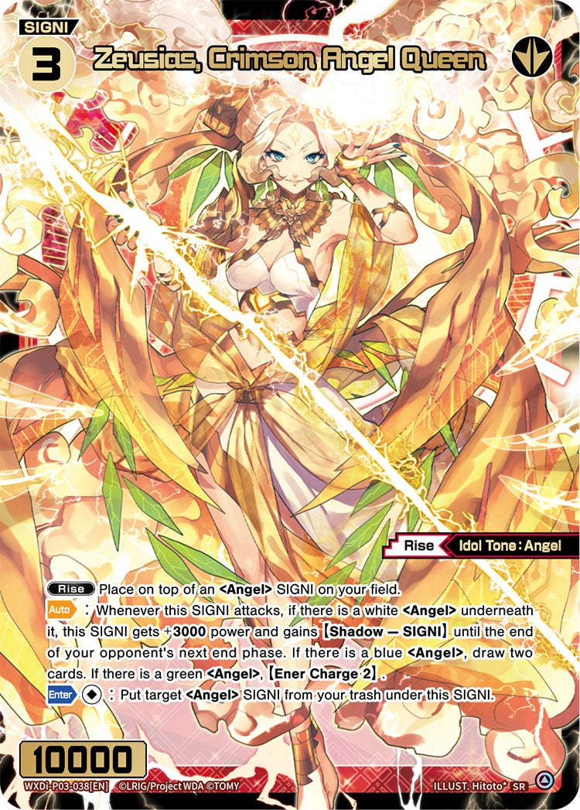

# Zeusias, Crimson Angel Queen

## Thông tin lá

| Trường | Giá trị |
| --- | --- |
| Mã in | WXDi-P03-038[EN] |
| Set | WXDi-P03[EN] |
| Số thứ tự | 038 |
| Loại thẻ | SIGNI |
| Vị trí | Main Deck |
| Số bản | — (set booster, không áp dụng) |
| Màu | Đỏ |
| Độ hiếm | SR |
| Minh họa | Hitoto* |
| Level | 3 |
| Limit | — |
| Power | 10000 |
| LRIG type / Class | Idol Tone：Angel |
| Team / Master | — |
| Cost | — |
| Grow cost | — |
| Use timing | — |
| Life Burst | Không |

## Card text chính thức

[Rise] Place on top of an <Angel> SIGNI on your field.
[Auto]: Whenever this SIGNI attacks, if there is a white <Angel> underneath it, this SIGNI gets +3000 power and gains 【Shadow — SIGNI】 until the end of your opponent's next end phase. If there is a blue <Angel>, draw two cards. If there is a green <Angel>, 【Ener Charge 2】.
[Enter] {Colorless}: Put target <Angel> SIGNI from your trash under this SIGNI.

## Power text / Life Burst

—

## Ghi chú minh họa
Artist: Hitoto*. Ảnh SR được tải từ Card List tiếng Anh.

## FAQ chính thức

**Q. Is the [Shadow (SIGNI)] ability no longer targeted by a SIGNI's Life Burst ability?**
A. Yes, Life Burst can also be prevented from being targeted by this ability if it is SIGNI.

**Q. If the card I paid as the Ener cost of [Enter] ability is an <Angel>, can I choose it as the card to place under this SIGNI?**
A. Yes, after paying the cost, you activate the ability and choose the target, so if it is an <Angel>, you can choose it.

## Nguồn
[Card List/FAQ chính thức](https://www.takaratomy.co.jp/products/en.wixoss/card/card.html?card_no=WXDi-P03-038%5BEN%5D ) · [Ảnh thẻ](https://www.takaratomy.co.jp/products/en.wixoss/card/thumb/WXDi-P03-038%5BEN%5D.jpg)
