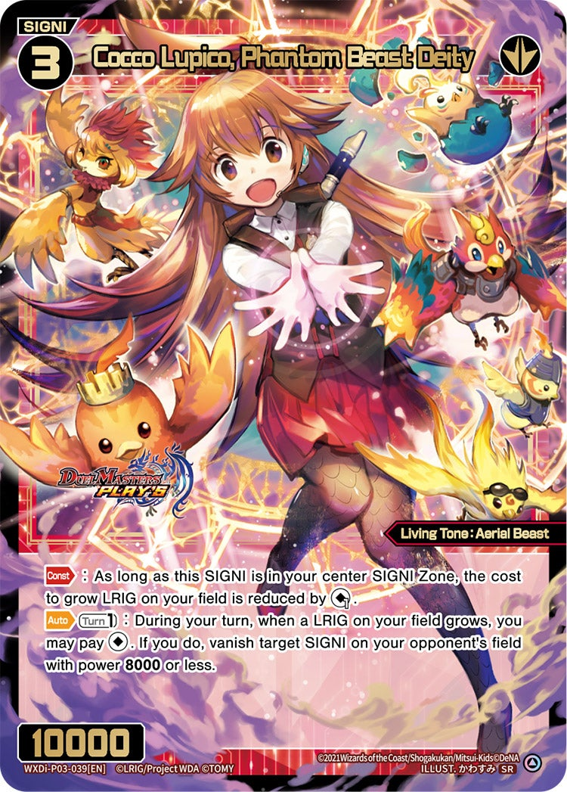

# Cocco Lupico, Phantom Beast Deity

## Thông tin lá

| Trường | Giá trị |
| --- | --- |
| Mã in | WXDi-P03-039[EN] |
| Set | WXDi-P03[EN] |
| Số thứ tự | 039 |
| Loại thẻ | SIGNI |
| Vị trí | Main Deck |
| Số bản | — (set booster, không áp dụng) |
| Màu | Đỏ |
| Độ hiếm | SR |
| Minh họa | かわすみ |
| Level | 3 |
| Limit | — |
| Power | 10000 |
| LRIG type / Class | Living Tone：Aerial Beast |
| Team / Master | — |
| Cost | — |
| Grow cost | — |
| Use timing | — |
| Life Burst | Không |

## Card text chính thức

[Constant]: As long as this SIGNI is in your center SIGNI Zone, the cost to grow LRIG on your field is reduced by {Colorlessx1}.
[Auto] {1/Turn}: During your turn, when a LRIG on your field grows, you may pay {Colorless}. If you do, vanish target SIGNI on your opponent's field with power 8000 or less.

## Power text / Life Burst

—

## Ghi chú minh họa
Artist: かわすみ. Ảnh SR được tải từ Card List tiếng Anh.

## FAQ chính thức

**Q. Is this [Auto] ability triggered by the grow of the center LRIG or the grow of the assist LRIG?**
A. Yes, it is triggered in both cases.

## Nguồn
[Card List/FAQ chính thức](https://www.takaratomy.co.jp/products/en.wixoss/card/card.html?card_no=WXDi-P03-039%5BEN%5D ) · [Ảnh thẻ](https://www.takaratomy.co.jp/products/en.wixoss/card/thumb/WXDi-P03-039%5BEN%5D.jpg)
