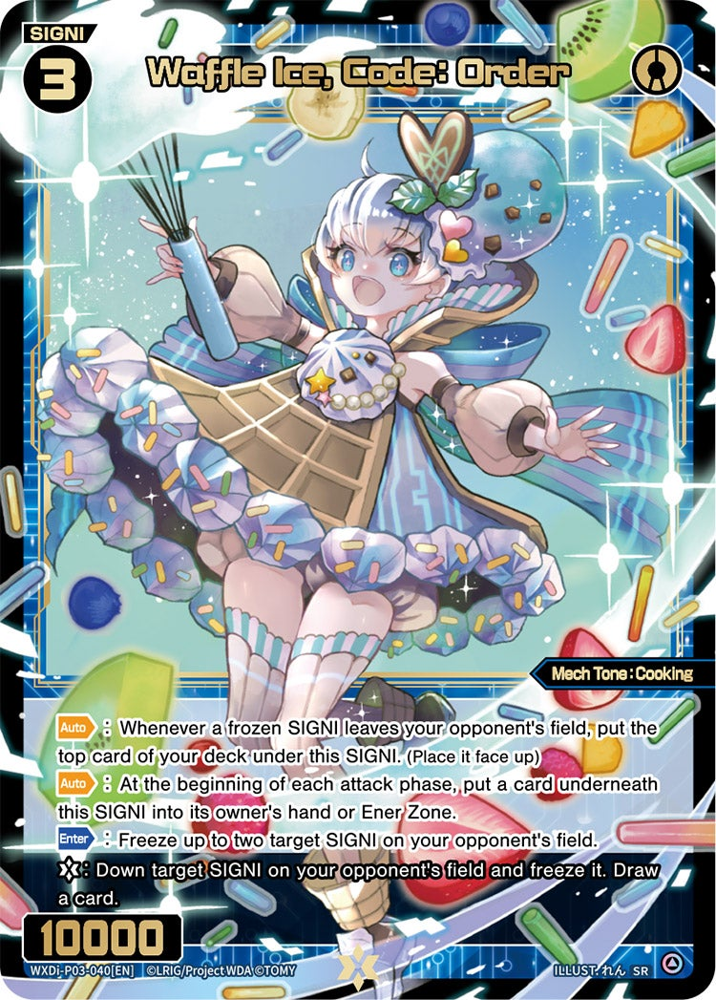

# Waffle Ice, Code: Order

## Thông tin lá

| Trường | Giá trị |
| --- | --- |
| Mã in | WXDi-P03-040[EN] |
| Set | WXDi-P03[EN] |
| Số thứ tự | 040 |
| Loại thẻ | SIGNI |
| Vị trí | Main Deck |
| Số bản | — (set booster, không áp dụng) |
| Màu | Xanh dương |
| Độ hiếm | SR |
| Minh họa | れん |
| Level | 3 |
| Limit | — |
| Power | 10000 |
| LRIG type / Class | Mech Tone：Cooking |
| Team / Master | — |
| Cost | — |
| Grow cost | — |
| Use timing | — |
| Life Burst | Có |

## Card text chính thức

[Auto]: Whenever a frozen SIGNI leaves your opponent's field, put the top card of your deck under this SIGNI. (Place it face up)
[Auto]: At the beginning of each attack phase, put a card underneath this SIGNI into its owner's hand or Ener Zone.
[Enter]: Freeze up to two target SIGNI on your opponent's field.

## Power text / Life Burst

Down target SIGNI on your opponent's field and freeze it. Draw a card.

## Ghi chú minh họa
Artist: れん. Ảnh SR được tải từ Card List tiếng Anh.

## FAQ chính thức

**Q. Is it possible to not use the [Auto] ability?**
A. Yes, [Auto] ability that meets the conditions is activated compulsorily. The [Auto] ability above forces you to place the top card of the deck under this SIGNI, or to add a card under this SIGNI to your hand or put it into the Ener Zone at the beginning of the Attack phase.

**Q. When "Waffle Ice, Code: Order " is vanished, what happens to the cards placed under it?**
A. Like cards placed under by [Rise], etc., if the top card leaves the field, the card placed under is put into the Trash by the rule process.

## Nguồn
[Card List/FAQ chính thức](https://www.takaratomy.co.jp/products/en.wixoss/card/card.html?card_no=WXDi-P03-040%5BEN%5D ) · [Ảnh thẻ](https://www.takaratomy.co.jp/products/en.wixoss/card/thumb/WXDi-P03-040%5BEN%5D.jpg)
