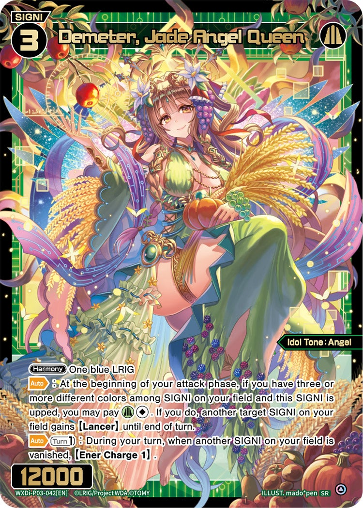

# Demeter, Jade Angel Queen

## Thông tin lá

| Trường | Giá trị |
| --- | --- |
| Mã in | WXDi-P03-042[EN] |
| Set | WXDi-P03[EN] |
| Số thứ tự | 042 |
| Loại thẻ | SIGNI |
| Vị trí | Main Deck |
| Số bản | — (set booster, không áp dụng) |
| Màu | Xanh lá |
| Độ hiếm | SR |
| Minh họa | mado*pen |
| Level | 3 |
| Limit | — |
| Power | 12000 |
| LRIG type / Class | Idol Tone：Angel |
| Team / Master | — |
| Cost | — |
| Grow cost | — |
| Use timing | — |
| Life Burst | Không |

## Card text chính thức

[Harmony] One blue LRIG
[Auto]: At the beginning of your attack phase, if you have three or more different colors among SIGNI on your field and this SIGNI is upped, you may pay {Green} {Colorless}. If you do, another target SIGNI on your field gains 【Lancer】 until end of turn.
[Auto] {1/Turn}: During your turn, when another SIGNI on your field is vanished, 【Ener Charge 1】.

## Power text / Life Burst

—

## Ghi chú minh họa
Artist: mado*pen. Ảnh SR được tải từ Card List tiếng Anh.

## FAQ chính thức

**Q. Does a SIGNI with two colors, such as "Green Gas Type: Eins" count as two different color types?**
A. Yes, it is counted. For example, "Green Gas Type: Eins" is green and black, so if there is another color, it will satisfy the above [Auto] ability.

**Q. If "Demeter, Jade Angle Queen" and one other SIGNI are simultaneously vanished by "Umr =Shatter=" etc., will the [Auto] ability below trigger?**
A. Yes, it is triggered.

## Nguồn
[Card List/FAQ chính thức](https://www.takaratomy.co.jp/products/en.wixoss/card/card.html?card_no=WXDi-P03-042%5BEN%5D ) · [Ảnh thẻ](https://www.takaratomy.co.jp/products/en.wixoss/card/thumb/WXDi-P03-042%5BEN%5D.jpg)
