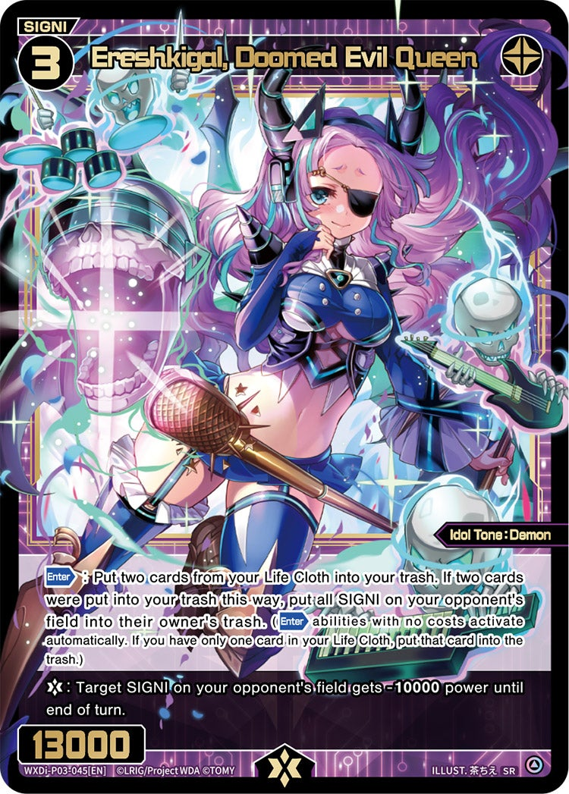

# Ereshkigal, Doomed Evil Queen

## Thông tin lá

| Trường | Giá trị |
| --- | --- |
| Mã in | WXDi-P03-045[EN] |
| Set | WXDi-P03[EN] |
| Số thứ tự | 045 |
| Loại thẻ | SIGNI |
| Vị trí | Main Deck |
| Số bản | — (set booster, không áp dụng) |
| Màu | Đen |
| Độ hiếm | SR |
| Minh họa | 茶ちえ |
| Level | 3 |
| Limit | — |
| Power | 13000 |
| LRIG type / Class | Idol Tone：Demon |
| Team / Master | — |
| Cost | — |
| Grow cost | — |
| Use timing | — |
| Life Burst | Có |

## Card text chính thức

[Enter]: Put two cards from your Life Cloth into your trash. If two cards were put into your trash this way, put all SIGNI on your opponent's field into their owner's trash. ([Enter] abilities with no costs activate automatically. If you have only one card in your Life Cloth, put that card into the trash.)

## Power text / Life Burst

Target SIGNI on your opponent's field gets -10000 power until end of turn.

## Ghi chú minh họa
Artist: 茶ちえ. Ảnh SR được tải từ Card List tiếng Anh.

## FAQ chính thức

**Q. Will SIGNI in my opponent's hand or in my opponent's Ener Zone be put into the Trash by this effect?**
A. No. In the case of an effect that affects SIGNI without specific zone, only the SIGNI on the field is affected. In this effect, only the SIGNI on the opponent's field is put into your opponent's Trash.

## Nguồn
[Card List/FAQ chính thức](https://www.takaratomy.co.jp/products/en.wixoss/card/card.html?card_no=WXDi-P03-045%5BEN%5D ) · [Ảnh thẻ](https://www.takaratomy.co.jp/products/en.wixoss/card/thumb/WXDi-P03-045%5BEN%5D.jpg)
