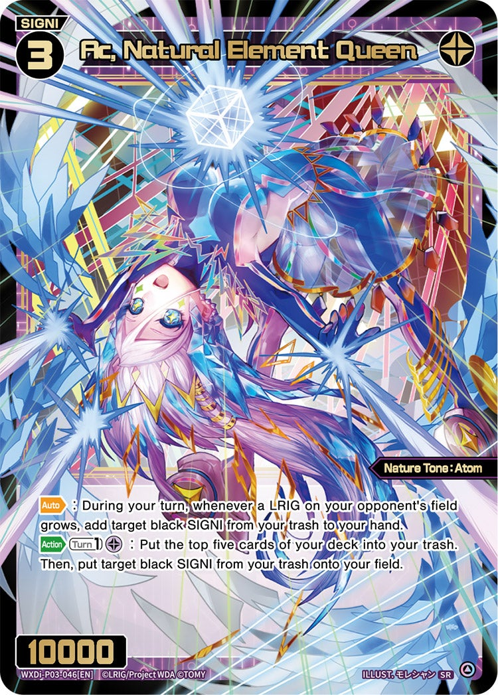

# Ac, Natural Element Queen

## Thông tin lá

| Trường | Giá trị |
| --- | --- |
| Mã in | WXDi-P03-046[EN] |
| Set | WXDi-P03[EN] |
| Số thứ tự | 046 |
| Loại thẻ | SIGNI |
| Vị trí | Main Deck |
| Số bản | — (set booster, không áp dụng) |
| Màu | Đen |
| Độ hiếm | SR |
| Minh họa | モレシャン |
| Level | 3 |
| Limit | — |
| Power | 10000 |
| LRIG type / Class | Nature Tone：Atom |
| Team / Master | — |
| Cost | — |
| Grow cost | — |
| Use timing | — |
| Life Burst | Không |

## Card text chính thức

[Auto]: During your turn, whenever a LRIG on your opponent's field grows, add target black SIGNI from your trash to your hand.
[Action] {1/Turn} {Black}: Put the top five cards of your deck into your trash. Then, put target black SIGNI from your trash onto your field.

## Power text / Life Burst

—

## Ghi chú minh họa
Artist: モレシャン. Ảnh SR được tải từ Card List tiếng Anh.

## FAQ chính thức

**Q. My opponent's assist LRIG grows and triggers its [Auto] ability. Which triggers first, the opponent's Assist LRIG's [Enter] ability or this [Auto] ability?**
A. Since it is your turn, your [Auto] ability as the turn player is triggered first.

**Q. When does [Action] ability target one black SIGNI in yorur Trash?**
A. It is after paying the cost and put 5 cards from the top of the deck into your Trash. You can choose the target cards, including those newly put into the Trash.

**Q. What happens if I use [Action] ability when I have 4 or less cards left in my deck?**
A. In this case, all remaining decks are put into your Trash. The deck will be reduced to zero, but Refresh is not performed while the effect is being processed, so this effect is processed to the end, and then Refresh is performed.

## Nguồn
[Card List/FAQ chính thức](https://www.takaratomy.co.jp/products/en.wixoss/card/card.html?card_no=WXDi-P03-046%5BEN%5D ) · [Ảnh thẻ](https://www.takaratomy.co.jp/products/en.wixoss/card/thumb/WXDi-P03-046%5BEN%5D.jpg)
